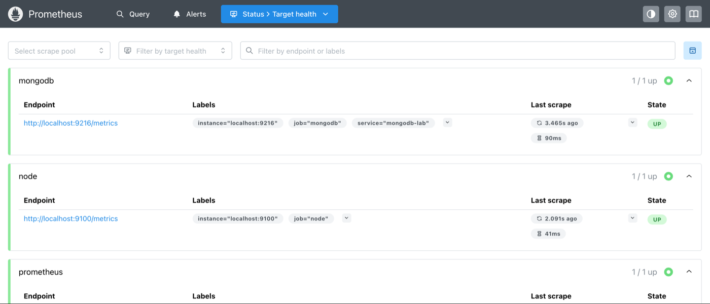
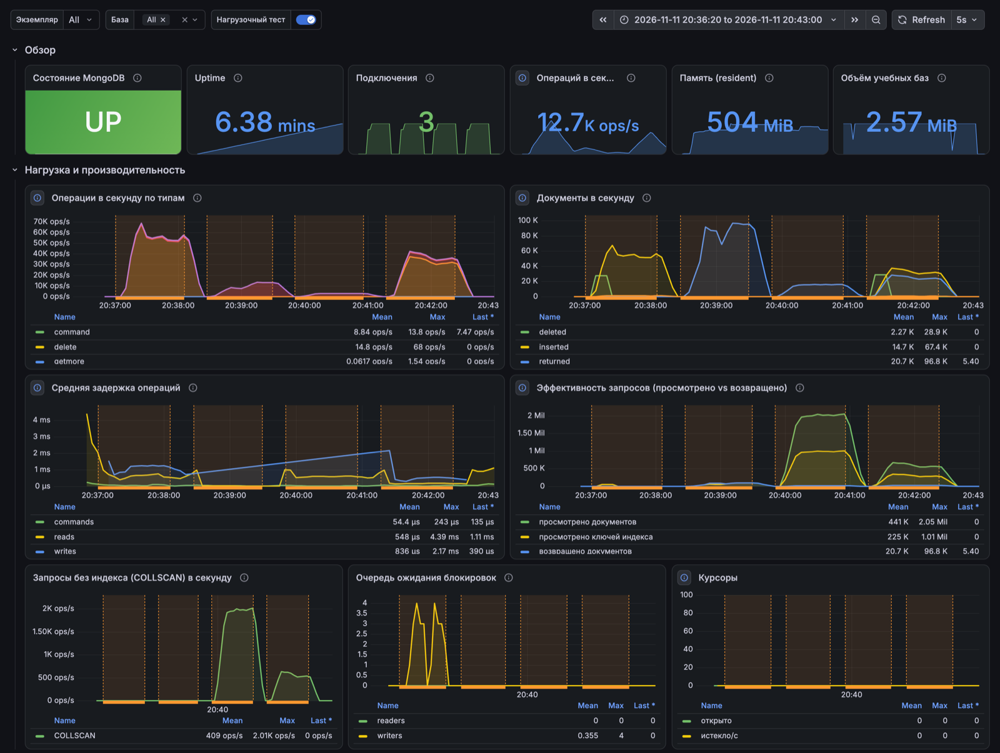
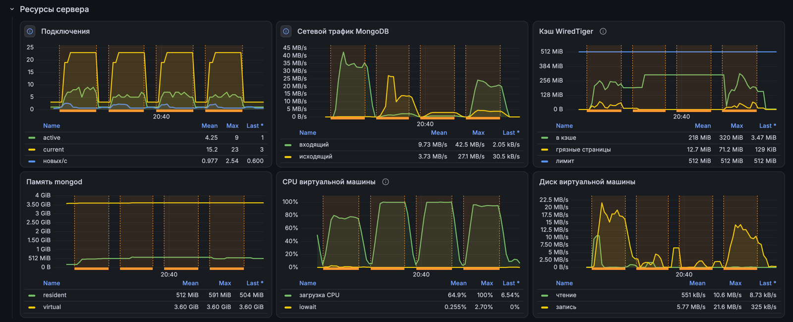
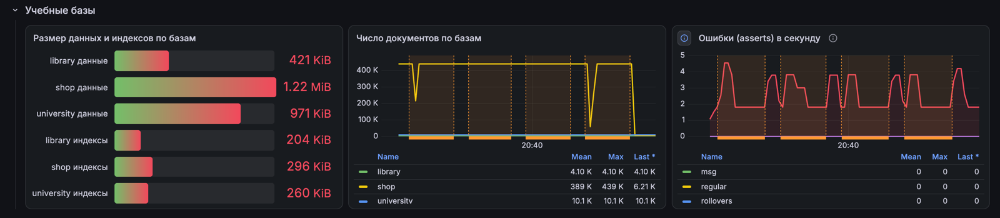
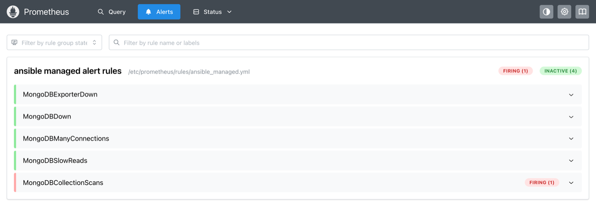

# Отчёт по лабораторной работе № 1

**Дисциплина:** Нереляционные базы данных
**Тема:** Эксплуатация MongoDB без Docker: развёртывание, ролевая модель, резервное копирование, мониторинг
**Дата:** 09.11.2026

---

## 1. Цель работы

Получить навыки сопровождения MongoDB на виртуальной машине без контейнеров: установить
и настроить экземпляр, управлять им как службой, разграничить доступ ролевой моделью,
организовать резервное копирование и восстановление, настроить мониторинг и посмотреть,
как нагрузка отражается на метриках. Вся настройка выполнена декларативно с помощью Ansible.

## 2. Задание

1. **Базовая настройка.** Развернуть MongoDB на ВМ без Docker, настроить автозапуск после
   перезагрузки, реализовать запуск/остановку/перезапуск, написать проверку доступности.
2. **Ролевая модель.** Создать пользователей и собственные роли с разными наборами операций,
   назначать и отзывать роли, изменять операции у роли, выдать доступ только к одной
   коллекции, удалять роли и пользователей.
3. **Резервное копирование.** Делать копии одной базы и всех учебных баз так, чтобы копии
   не перезаписывали друг друга; восстанавливать отдельную коллекцию.
4. **Мониторинг.** Выбрать экспортер, обосновать набор метрик, построить дашборд, подать
   нагрузку и показать её влияние на графики.

## 3. Среда выполнения

| Компонент | Версия |
|---|---|
| Управляющая машина | macOS 26.6 (Apple Silicon), Ansible core 2.21.6 |
| Виртуализация | Multipass 1.16.4 |
| ВМ | Ubuntu 24.04.5 LTS aarch64, 2 vCPU, 4 ГБ ОЗУ, 20 ГБ диск |
| СУБД | MongoDB Community 8.0.34, mongosh 2.14.1 |
| Мониторинг | Percona mongodb_exporter 0.54.0, node_exporter 1.12.1, Prometheus 3.14.0, Grafana 13.3.0 |
| Коллекции Ansible | community.mongodb 1.8.1, prometheus.prometheus 0.30.2, grafana.grafana 6.1.0, community.general 13.5.1, ansible.posix 2.2.2 |

ВМ создаётся одной командой, SSH-ключ для Ansible передаётся через cloud-init
(в `cloud-init.yml.example` подставить свой публичный ключ):
```bash
multipass launch 24.04 --name mongo-lab --cpus 2 --memory 4G --disk 20G --cloud-init cloud-init.yml
```

### Почему Ansible

Ansible описывает желаемое состояние системы, а не последовательность команд: повторный
запуск ничего не меняет (идемпотентность), шаблоны конфигов и проверки состояния есть из коробки,
а готовые роли сообщества (`prometheus.prometheus`, `grafana.grafana`) и модули
`community.mongodb` избавляют от собственного кода установки. Агент на ВМ не нужен — только SSH.

### Структура проекта

```
lab-1-mongo/
├── ansible.cfg, requirements.yml     # настройки и версии коллекций
├── inventory/
│   ├── hosts.yml                     # ВМ mongo-lab
│   └── group_vars/mongodb/
│       ├── main.yml                  # параметры MongoDB, бэкапов, нагрузки
│       ├── monitoring.yml            # переменные ролей Prometheus/Grafana
│       └── vault.yml                 # пароли (в реальной среде — ansible-vault encrypt)
├── site.yml                          # всё развёртывание одной командой
├── roles/
│   ├── host_prep/                    # THP, sysctl, лимиты, chrony, venv с pymongo
│   ├── mongodb/                      # репозиторий, пакеты, mongod.conf, systemd, администратор
│   ├── lab_data/                     # учебные базы shop, library, university
│   ├── rbac/                         # роли и пользователи по описанию + проверка доступа
│   └── mongodb_backup/               # пользователь, скрипт mongo-backup, systemd-таймер
├── rbac/01-initial.yml … 05-drop.yml # шаги задания части 2 как состояния
└── playbooks/
    ├── setup.yml, service.yml, healthcheck.yml          # часть 1
    ├── rbac.yml                                         # часть 2
    ├── backup.yml, restore.yml                          # часть 3
    ├── monitoring.yml, monitoring_check.yml, load.yml   # часть 4
    └── files/                                           # дашборд Grafana, сценарий нагрузки
```

---

## 4. Ход выполнения

### 4.1. Часть 1. Базовая настройка

`ansible-playbook playbooks/setup.yml` применяет три роли:

| Роль | Что делает |
|---|---|
| `host_prep` | Проверка ОС/архитектуры/ОЗУ, пакеты, юнит `disable-thp.service` (отключение Transparent Huge Pages до старта mongod), `vm.swappiness=1`, `vm.max_map_count`, лимиты `nofile/nproc=64000` для пользователя mongodb, chrony. Создаёт venv `/opt/mongo-lab/venv` с pymongo 4 — в Ubuntu 24.04 пакет `python3-pymongo` версии 3.11, а модулям `community.mongodb` нужен 4.x |
| `mongodb` | Ключ и APT-репозиторий MongoDB 8.0, пакет `mongodb-org`, фиксация версии (`dpkg_selections: hold`), шаблон `/etc/mongod.conf` (кэш WiredTiger, журнал, bindIp, профилирование операций > 100 мс, `authorization: enabled`), drop-in `override.conf` для systemd (`Restart=on-failure`, лимиты, запуск после `disable-thp`), автозапуск. Администратор создаётся модулем `mongodb_user` через localhost exception, затем проверяется, что без пароля данные недоступны |
| `lab_data` | Учебные базы: shop (customers 1000, products 200, orders 5000), library (authors 100, books 1000, loans 3000), university (students 2000, courses 50, enrollments 8000) с индексами. Существующие базы не перезаписываются |

Первый запуск и повторный (идемпотентность):
```
TASK [lab_data : Seed result]
  "msg": "created shop: customers=1000, products=200, orders=5000
          created library: authors=100, books=1000, loans=3000
          created university: students=2000, courses=50, enrollments=8000"
PLAY RECAP   mongo-lab : ok=25   changed=19   failed=0
# повторно:
PLAY RECAP   mongo-lab : ok=22   changed=0    failed=0
```

**Управление сервером** — `playbooks/service.yml -e op=start|stop|restart|status`. После запуска
плейбук ждёт открытия порта, после остановки — его закрытия, и печатает состояние юнита.

**Проверка доступности** — `playbooks/healthcheck.yml`: служба и автозапуск, TCP-порт, вход
администратора с `ping` и `serverStatus`, доля занятых подключений, память, место на диске.
Каждой проверке присваивается OK / WARNING / CRITICAL; при любом CRITICAL плейбук завершается
с ошибкой (ненулевой код возврата), поэтому его можно вызывать из CI или по расписанию.

```
$ ansible-playbook playbooks/healthcheck.yml
  "OK  service  mongod running",
  "OK  autostart  enabled",
  "OK  tcp  127.0.0.1:27017 accepts connections",
  "OK  auth  admin login ok, MongoDB 8.0.34, uptime 166 s, ping 6 ms, dbs: 6",
  "OK  connections  7 current, 993 available (0.7%)",
  "OK  memory  resident 191 MB",
  "OK  disk  / used 31%, free 12.7 GB"
  "msg": "MongoDB mongo-lab: OK"
```

Остановленный сервер:
```
$ ansible-playbook playbooks/service.yml -e op=stop
$ ansible-playbook playbooks/healthcheck.yml
  "CRITICAL  service  mongod stopped",
  "OK  autostart  enabled",
  "CRITICAL  tcp  127.0.0.1:27017 closed",
  "CRITICAL  auth  login/ping failed",
  "UNKNOWN  connections  -",
  "UNKNOWN  memory  -",
  "OK  disk  / used 31%, free 12.7 GB"
[ERROR]: Task failed: Action failed: MongoDB mongo-lab: CRITICAL
$ ansible-playbook playbooks/service.yml -e op=start
  "msg": {"ActiveState": "active", "MainPID": "2948", "SubState": "running", "UnitFileState": "enabled"}
```

**Автозапуск** проверен перезагрузкой ВМ (`ansible mongodb -b -m reboot`). Через 13 с после
загрузки без каких-либо действий:
```
  "OK  auth  admin login ok, MongoDB 8.0.34, uptime 6 s, ping 9 ms, dbs: 6",
  "msg": "MongoDB mongo-lab: OK"
$ cat /sys/kernel/mm/transparent_hugepage/enabled
always madvise [never]
```

### 4.2. Часть 2. Ролевая модель

Роли и пользователи описываются данными, роль `rbac` приводит сервер к этому описанию
модулями `mongodb_role` и `mongodb_user`: сначала создаёт/обновляет роли, затем пользователей,
удаление — в обратном порядке. Каждый шаг задания — отдельный файл с полным желаемым
состоянием, а после применения плейбук от имени каждого проверяемого пользователя реально
пробует find / insert / update / remove и печатает матрицу (`+` разрешено, `-` запрещено).

```bash
ansible-playbook playbooks/rbac.yml -e @rbac/01-initial.yml
```

| Роль | База | Привилегии |
|---|---|---|
| `shopReader` | shop | find, listCollections, collStats, dbStats на всю базу |
| `shopEditor` | shop | find, insert, update, listCollections (без удаления) |
| `gradeEditor` | university | find на всю базу + update только на `enrollments` |
| `loansWriter` | library | find, insert, update, remove только на коллекцию `loans` |

**Шаг 1 — пользователи, роли, назначение** (`rbac/01-initial.yml`):
```
shop_manager (shopEditor)          univ_teacher (gradeEditor)
collection  find insert update remove     collection   find insert update remove
orders      +    +      +      -          students     +    -      -      -
products    +    +      +      -          enrollments  +    -      +      -

library_clerk (ролей нет)
loans       -    -      -      -
db level: listCollections -  dbStats -
```

**Шаг 2 — отзыв роли** у `shop_manager` (`rbac/02-revoke.yml`):
```
changed: (item=shop_manager: -)
orders      -    -      -      -
```

**Шаг 3 — изменение операций роли** `shopEditor`: добавлен `remove`, убран `update`; права
владельца роли меняются сразу (`rbac/03-modify-role.yml`):
```
changed: (item=shopEditor@shop)
orders      +    +      -      +
```

**Шаг 4 — доступ только к одной коллекции** (`rbac/04-collection-access.yml`):
```
library_clerk (loansWriter)
collection  find insert update remove
loans       +    +      +      +
books       -    -      -      -
authors     -    -      -      -
db level: listCollections -  dbStats -
```

**Шаг 5 — удаление роли и пользователя** (`rbac/05-drop.yml`):
```
changed: (item=shop_analyst)        # пользователь удалён
changed: (item=shopReader@shop)     # роль удалена
"login failed for shop_analyst: MongoServerError: Authentication failed."
```

Повторное применение любого шага даёт `changed=0`.

### 4.3. Часть 3. Резервное копирование и восстановление

Роль `mongodb_backup` создаёт пользователя `backup_operator` (встроенные роли `backup` и
`restore`), файл с паролем для mongodump/mongorestore (`/etc/mongo-backup/tools.yml`, права 600),
скрипт `/usr/local/bin/mongo-backup` и systemd-таймер ежедневного бэкапа (вместо cron:
`Persistent=true` догоняет пропущенный запуск, логи в journald).

* `mongo-backup db shop` → `/var/backups/mongodb/db-shop/<дата_время>/`,
  `mongo-backup all` → `/var/backups/mongodb/all/<дата_время>/`.
* **Копии не перезаписывают друг друга:** каждая пишется в новый каталог с меткой времени
  (при совпадении секунды — суффикс `_2`), сначала как `*.partial`, и переименовывается только
  после успешного mongodump. Хранятся 5 последних копий каждой цели.
* В каждой копии `manifest.json`: время, базы, размер и число документов по коллекциям
  (считается по самому дампу).

```bash
ansible-playbook playbooks/backup.yml -e target=shop    # копия одной базы
ansible-playbook playbooks/backup.yml -e target=all     # копия всех учебных баз
```
```
"TARGET     COPY                     SIZE  DATABASES / DOCS",
"all        2026-11-09_22-35-27      448K  shop,library,university / 20350",
"db-shop    2026-11-09_22-35-23      224K  shop / 6200",
"db-shop    2026-11-09_22-35-31      224K  shop / 6200"
```
Ротация после ещё четырёх копий shop и запуска через таймерный юнит:
```
rotate: removed /var/backups/mongodb/db-shop/2026-11-09_22-35-23
$ systemctl start mongo-backup.service      → Result=success
backup all -> /var/backups/mongodb/all/2026-11-09_22-35-50 (448K)
```

**Восстановление коллекции** — `playbooks/restore.yml` находит самую свежую копию, где есть
коллекция, выполняет `mongorestore --nsInclude=<db>.<coll> --drop` (вместе с индексами) и
сверяет число документов с manifest. Параметры: `-e from=<каталог копии>`,
`-e to_db=<база>` — восстановить рядом, не трогая исходную.

```
до удаления: orders = 5000, индексов 3
после drop:  customers, products
$ ansible-playbook playbooks/restore.yml -e db=shop -e collection=orders
"msg": "shop.orders: in backup 5000, in db 5000, indexes _id_,customer_id_1_created_-1,status_1
        (from /var/backups/mongodb/all/2026-11-09_22-35-50)"

$ ansible-playbook playbooks/restore.yml -e db=library -e collection=loans -e to_db=library_restored
"msg": "library_restored.loans: in backup 3000, in db 3000, indexes _id_,book_id_1_issued_-1"
```

### 4.4. Часть 4. Мониторинг

`ansible-playbook playbooks/monitoring.yml` создаёт пользователя экспортера и применяет
роли `prometheus.prometheus.node_exporter`, `.mongodb_exporter`, `.prometheus` и
`grafana.grafana.grafana`. Все компоненты — службы systemd.

Схема: `mongod → mongodb_exporter :9216 → Prometheus :9090 (опрос раз в 5 с) → Grafana :3000`,
плюс `node_exporter :9100` для метрик ВМ.

**Экспортер — Percona mongodb_exporter.** Активно развивается, поддерживает MongoDB 8.x,
используется в Percona Monitoring and Management, снимает `getDiagnosticData` (данные FTDC),
`dbStats`, `collStats`, `indexStats` и `top`; для него есть готовая роль в официальной
коллекции `prometheus.prometheus`. Экспортер подключается под пользователем с ролями
`clusterMonitor` и `read@local` — только чтение статистики.

**Метрики и зачем они нужны:**

| Группа | Метрика | Зачем |
|---|---|---|
| Доступность | `mongodb_up`, `mongodb_ss_uptime` | жив ли сервер; сброс uptime — перезапуск |
| Пропускная способность | `rate(mongodb_ss_opcounters[..])` по `legacy_op_type` | операций в секунду по типам — основной индикатор нагрузки |
| Документы | `rate(mongodb_ss_metrics_document[..])` | сколько документов читается/пишется (одна операция может затронуть тысячи) |
| Задержка | `rate(..._opLatencies_latency) / rate(..._opLatencies_ops)` | среднее время чтения, записи, команд — то, что видит приложение |
| Эффективность запросов | `..._queryExecutor_scannedObjects`, `_scanned`, `_collectionScans_total` | просмотрено много больше, чем возвращено, или растут COLLSCAN — не хватает индекса |
| Блокировки | `mongodb_ss_globalLock_currentQueue` | операции в очереди на блокировку |
| Подключения | `mongodb_ss_connections{conn_type=current\|active\|totalCreated}` | исчерпание лимита, шторм переподключений |
| Кэш WiredTiger | `..._cache_bytes_currently_in_the_cache`, грязные страницы, лимит кэша | заполнение кэша, давление записи |
| Память, сеть | `mongodb_ss_mem_resident`, `mongodb_ss_network_bytesIn/Out` | RAM и трафик |
| Ошибки | `rate(mongodb_ss_asserts[..])` | ошибки запросов, нарушения уникальности |
| Учебные базы | `mongodb_dbstats_dataSize`, `_indexSize`, `_objects` | рост данных и индексов |
| Хост | `node_cpu_seconds_total`, `node_disk_*_bytes_total` | влияние нагрузки на CPU и диск |

Правила алертов (переменная `prometheus_alert_rules`): экспортер недоступен, MongoDB down,
подключений > 80 % лимита, средняя задержка чтения > 100 мс, частые COLLSCAN.

**Дашборд** `playbooks/files/grafana/dashboards/mongodb-lab.json` подключается через
provisioning и открывается как домашний, обновление каждые 5 с, фильтры «Экземпляр» и «База».
Разделы: обзор (UP/DOWN, uptime, подключения, ops/s, память, объём баз); нагрузка
(операции по типам, документы/с, задержка, просмотрено/возвращено, COLLSCAN/с, очередь
блокировок, курсоры); ресурсы (подключения, трафик, кэш WiredTiger, память, CPU и диск ВМ);
учебные базы.

**Проверка** (`playbooks/monitoring_check.yml` выполняется в конце `monitoring.yml`):
службы запущены, у экспортера есть все нужные метрики и `mongodb_up = 1`, все цели Prometheus
в состоянии up, Grafana здорова, дашборд загружен, источник данных работает:
```
"targets: mongodb=up, node=up, prometheus=up",
"ops/s now: 11.6",
"grafana 13.3.0, dashboard: MongoDB Lab — состояние и производительность",
"http://192.168.252.4:3000/d/mongodb-lab"
```
Дополнительно все 32 запроса панелей дашборда выполнены напрямую в Prometheus за 10 минут
нагрузки — каждый возвращает данные.

Цели Prometheus (`Status → Target health`):



**Нагрузка** — `ansible-playbook playbooks/load.yml`. Плейбук создаёт пользователя
`load_tester` (readWrite только на shop) и запускает 4 параллельных процесса mongosh как
асинхронные задачи. Фазы идут по очереди с паузой 20 с, каждая длится 60 с и отмечается
аннотацией на дашборде:

| Фаза | Что делает |
|---|---|
| write | вставки пачками по 50 документов в `shop.load_events` (capped-коллекция 256 МБ, чтобы объём не рос без предела), изменение остатков, очистка |
| read | точечные запросы по индексам |
| scan | запросы по полям без индекса и агрегации `$unwind/$group` |
| mixed | смесь 50 / 35 / 15 % |

Сводка, которую печатает плейбук (прогон 11.11.2026, 20:37–20:42):
```
write: 65 s: insert 3502700, update 70054   ops/s ~ 55023, COLLSCAN 0,      scanned 883258,    returned 420      read latency 553 us
read:  62 s: query 662879                   ops/s ~ 10691, COLLSCAN 10,     scanned 5274240,   returned 5274600  read latency 28 us
scan:  65 s: query 179799                   ops/s ~ 2766,  COLLSCAN 119660, scanned 122223530, returned 957700   read latency 588 us
mixed: 65 s: insert 2018450, query 225063   ops/s ~ 35169, COLLSCAN 34386,  scanned 36874112,  returned 1537749  read latency 171 us
```

Дашборд за время этого прогона. Оранжевые полосы — аннотации фаз (write, read, scan, mixed
слева направо), между ними паузы по 20 с.







**Анализ.**
* **read** — ~10,7 тыс. операций/с, просмотрено столько же документов, сколько возвращено
  (линии на панели «Эффективность запросов» почти совпадают), средняя задержка чтения
  28 мкс: все запросы идут по индексам.
* **scan** — операций в 3,9 раза меньше, задержка чтения выше в ~21 раз, документов
  просматривается в 127 раз больше, чем возвращается (до 2 млн/с при ~15 тыс. возвращённых),
  COLLSCAN до 2010 в секунду, CPU ВМ упирается в 100 %. Так на графиках выглядит отсутствие
  индекса.
* **write** — пик операций (до 67 тыс. вставленных документов/с), входящий трафик до 42,5 МБ/с,
  кэш WiredTiger заполняется, грязные страницы до 71 МБ, запись на диск до 21,6 МБ/с. Очередь
  ожидания блокировок появляется только в этой фазе.
* **mixed** — все показатели одновременно, но ниже пиков отдельных фаз.

Через минуту частых COLLSCAN срабатывает правило `MongoDBCollectionScans`:



Если создать индекс `db.orders.createIndex({total: 1})`, запрос по `total` из фазы scan
перестаёт быть полным просмотром коллекции.

### 4.5. Развёртывание с нуля и идемпотентность

На новой ВМ всё выполнено одной командой:
```
$ time ansible-playbook site.yml
PLAY RECAP   mongo-lab : ok=191  changed=50   failed=0
"msg": "MongoDB mongo-lab: OK"
real 2m26s

$ ansible-playbook site.yml      # повторно
PLAY RECAP   mongo-lab : ok=178  changed=0    failed=0
```
После перезагрузки ВМ все службы (mongod, экспортеры, Prometheus, Grafana, таймер бэкапа)
поднялись сами, `healthcheck.yml` и `monitoring_check.yml` прошли без ошибок.
`ansible-lint` замечаний не выдаёт.

---

## 5. Сводка проверки

| Проверка | Результат |
|---|---|
| Установка и настройка MongoDB | ✓ 8.0.34, авторизация включена, анонимный доступ закрыт |
| Запуск / остановка / перезапуск, healthcheck | ✓ остановлен → CRITICAL и ошибка плейбука, запущен → OK |
| Автозапуск после перезагрузки | ✓ все службы, THP отключён |
| Ролевая модель, 5 шагов | ✓ матрицы доступа соответствуют ролям |
| Резервные копии | ✓ копии не перезаписываются, ротация 5, таймер работает |
| Восстановление коллекции | ✓ 5000 / 5000 документов, индексы восстановлены |
| Мониторинг | ✓ цели up, дашборд загружен, 32 / 32 запроса панелей с данными, алерт COLLSCAN срабатывает |
| Нагрузка | ✓ фазы различимы, эффект отсутствия индекса виден |
| `site.yml` с нуля / повторно | ✓ 2 мин 26 с / changed=0 |

**Проблемы, возникшие при выполнении, и решения:**
1. `community.mongodb` требует pymongo 4, а в Ubuntu 24.04 — 3.11. Решение: роль `host_prep`
   создаёт venv с pymongo 4, и он задан как интерпретатор Python для хоста.
2. Роли `prometheus.prometheus` скачивают и распаковывают архивы на управляющей машине,
   а для этого нужен GNU tar. На macOS: `brew install gnu-tar`.
3. В `grafana.grafana` 6.1.0 импорт дашбордов из каталога ломается на ansible-core 2.21
   (`regex_replace` по списку возвращает строку). Дашборд подключается своими двумя задачами
   в `monitoring.yml` (provider + JSON-файл).
4. Роль Grafana запрещает переменную `grafana_port` (старое имя) — используется `grafana_http_port`.

## 6. Выводы

1. MongoDB 8.0 развёрнута на ВМ без Docker как служба systemd с автозапуском, авторизацией
   и рекомендованными настройками ОС; проверка доступности оформлена плейбуком с понятными
   уровнями и ненулевым кодом возврата при сбое.
2. Ролевая модель MongoDB позволяет выдавать права с точностью до операции и коллекции.
   Описание ролей и пользователей данными делает каждое изменение воспроизводимым: изменение
   роли сразу действует на всех её владельцев, удаление роли отзывает её у пользователей.
3. Копии в каталогах с меткой времени с атомарным переименованием и ротацией не перезаписывают
   друг друга; коллекция восстанавливается с индексами, целостность подтверждается сверкой
   с manifest.
4. Связка mongodb_exporter + Prometheus + Grafana показывает не только объём нагрузки, но и её
   качество: по отношению «просмотрено / возвращено» и COLLSCAN сразу видно отсутствие индекса.
5. Ansible дал идемпотентность, проверяемую одной командой
   (`changed=0`), использование готовых ролей вместо собственного кода установки и развёртывание
   стенда с нуля за 2,5 минуты. Следующие шаги для промышленной среды — шифрование `vault.yml`,
   Molecule-тесты ролей и Percona Backup for MongoDB для point-in-time восстановления.

---

## Приложение. Запуск

```bash
brew install ansible gnu-tar                 # macOS; на Linux: pipx install ansible-core
cd lab-1-mongo
ansible-galaxy collection install -r requirements.yml -p collections
# указать IP ВМ в inventory/hosts.yml
ansible-playbook site.yml                    # всё сразу
```

По частям:
```bash
ansible-playbook playbooks/setup.yml
ansible-playbook playbooks/service.yml -e op=restart
ansible-playbook playbooks/healthcheck.yml
ansible-playbook playbooks/rbac.yml -e @rbac/01-initial.yml        # … 05-drop.yml
ansible-playbook playbooks/backup.yml -e target=all
ansible-playbook playbooks/restore.yml -e db=shop -e collection=orders
ansible-playbook playbooks/monitoring.yml
ansible-playbook playbooks/load.yml                                 # -e '{"phases": ["scan"]}'
```

Grafana: `http://<IP ВМ>:3000` (`admin / GrafanaPass123`), Prometheus: `http://<IP ВМ>:9090`.
Пароли — `inventory/group_vars/mongodb/vault.yml`.
