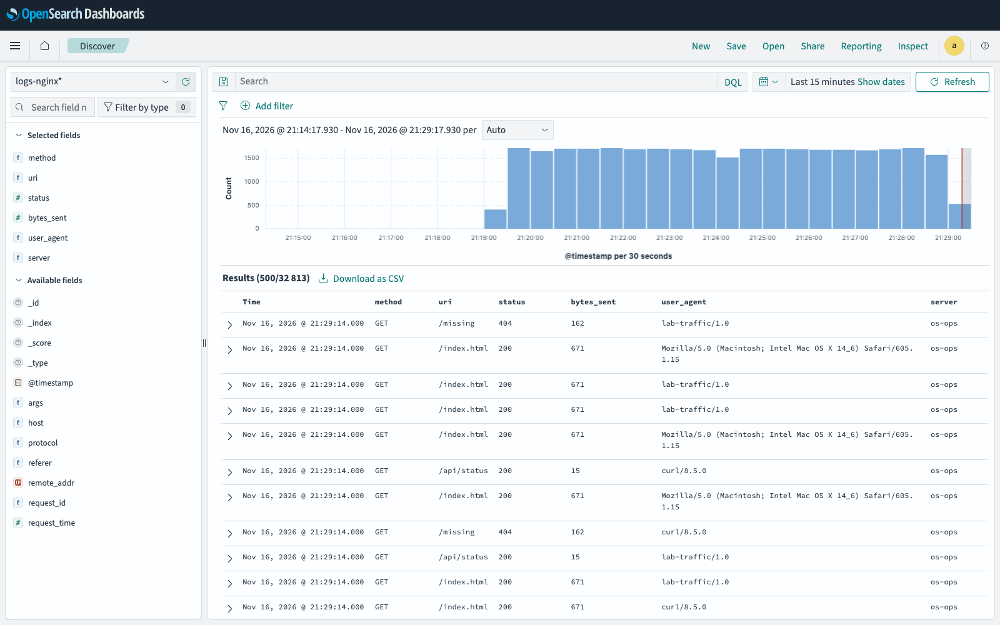
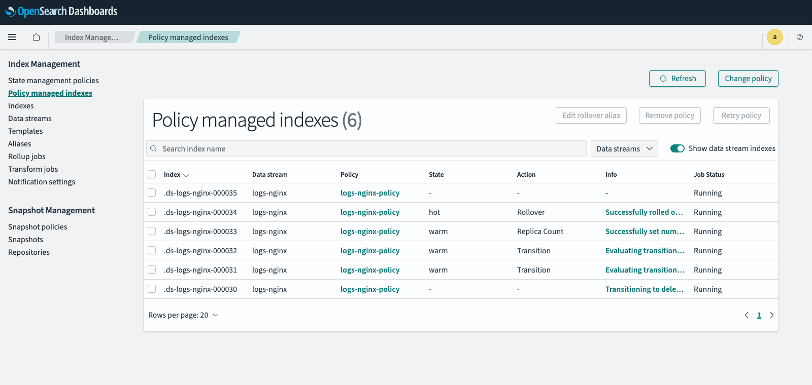
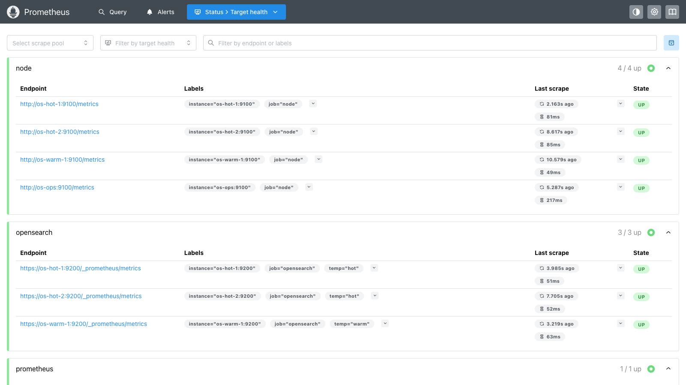
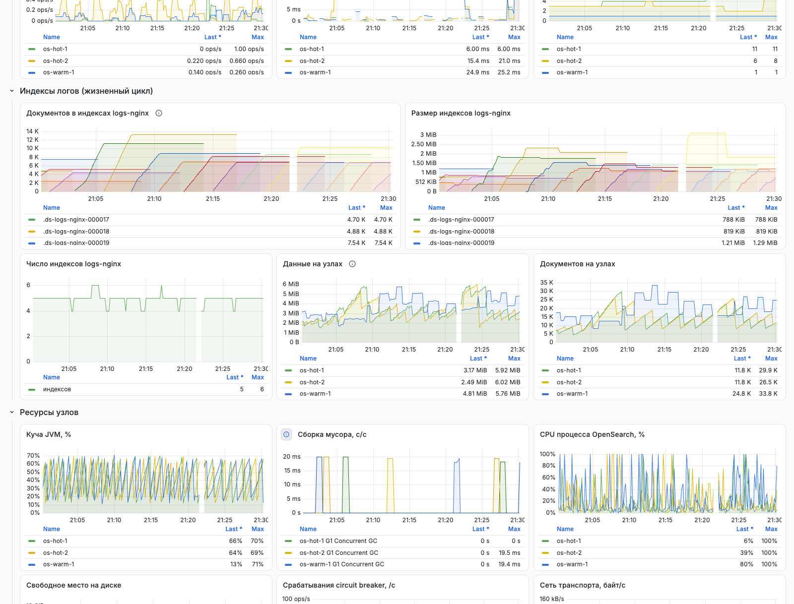
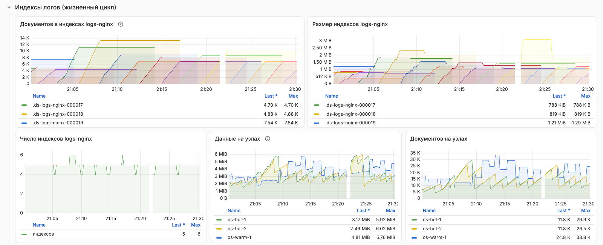
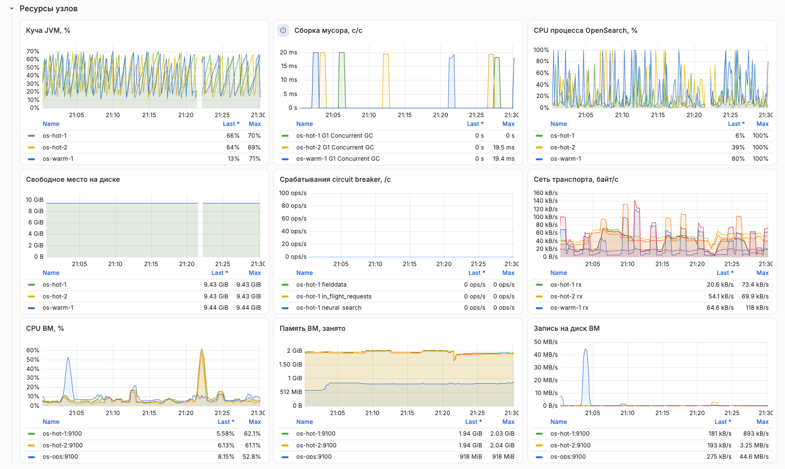

# Отчёт по лабораторной работе № 2

**Дисциплина:** Нереляционные базы данных
**Тема:** Эксплуатация OpenSearch 3.8: защищённый кластер Hot-Warm, ролевая модель, жизненный цикл логов, мониторинг
**Дата:** 16.11.2026

---

## 1. Цель работы

Получить навыки сопровождения кластера OpenSearch: развернуть защищённый кластер с разделением
узлов на hot и warm, разграничить доступ ролевой моделью, настроить автоматическое управление
жизненным циклом логов и подключить мониторинг. Вся настройка выполнена декларативно с помощью
Ansible.

## 2. Задание

1. **Развёртывание.** Кластер OpenSearch в архитектуре Hot-Warm, TLS на транспортном и REST
   уровне, OpenSearch Dashboards.
2. **Ролевая модель.** Роль записи (только в data stream логов), роль чтения (только чтение
   индексов `logs*`), роль мониторинга (минимум прав для метрик кластера и узлов); три
   пользователя с этими ролями.
3. **Управление индексами.** Страница на nginx с журналом в формате JSON, перекладчик логов
   в OpenSearch, шаблон индекса, политика хранения: удаление через 10 минут, новый индекс
   при размере 1 МБ или возрасте 1 минута (что наступит раньше).
4. **Мониторинг.** Плагин Prometheus для OpenSearch, выбор метрик, дашборд.

## 3. Среда выполнения

| Компонент | Версия |
|---|---|
| Управляющая машина | macOS 27.2 (Apple Silicon), Ansible core 2.21.6 |
| Виртуализация | Multipass 1.16.4 |
| ВМ | 4 × Ubuntu 24.04.5 LTS aarch64, 2 vCPU, 15 ГБ диск; узлы OpenSearch по 2,5 ГБ ОЗУ, os-ops 3 ГБ |
| OpenSearch, Dashboards | 3.8.0 (deb-пакеты), куча JVM 1 ГБ |
| Логи | nginx 1.24.0, Fluent Bit 5.2.0 |
| Мониторинг | prometheus-exporter 3.8.0.0 (плагин OpenSearch), Prometheus 3.14.0, node_exporter 1.12.1, Grafana 13.3.1 |
| Коллекции Ansible | community.crypto 3.5.1, ansible.posix 2.2.2, prometheus.prometheus 0.30.2 |

### Схема стенда

| ВМ | Роль в стенде | Роли узла OpenSearch | `node.attr.temp` |
|---|---|---|---|
| `os-hot-1` | узел кластера | cluster_manager, data, ingest | hot |
| `os-hot-2` | узел кластера | cluster_manager, data, ingest | hot |
| `os-warm-1` | узел кластера | cluster_manager, data | warm |
| `os-ops` | Dashboards, nginx, Fluent Bit, Prometheus, Grafana | — | — |

```
nginx (JSON-лог) → Fluent Bit ──HTTPS, logs_writer──▶ os-hot-1 / os-hot-2  (hot: приём и свежие индексы)
                                                          │ политика ISM
                                                          ▼
Dashboards ──HTTPS, kibanaserver──▶ кластер           os-warm-1          (warm: индексы после rollover)
Prometheus ──HTTPS, metrics_monitor──▶ /_prometheus/metrics на каждом узле → Grafana
```

Все три узла могут быть выбраны управляющим (кворум 2 из 3), поэтому отказ любого одного узла
не останавливает кластер. ВМ создаются одной командой каждая, SSH-ключ передаётся через
cloud-init (в `cloud-init.yml.example` подставить свой публичный ключ):

```bash
for vm in os-hot-1 os-hot-2 os-warm-1; do
  multipass launch 24.04 --name $vm --cpus 2 --memory 2.5G --disk 15G --cloud-init cloud-init.yml
done
multipass launch 24.04 --name os-ops --cpus 2 --memory 3G --disk 15G --cloud-init cloud-init.yml
```

### Структура проекта

```
lab-2-opensearch/
├── ansible.cfg, requirements.yml     # настройки и версии коллекций
├── fetch-artifacts.sh                # скачивание пакетов на управляющую машину и загрузка на ВМ
├── inventory/
│   ├── hosts.yml                     # группы hot, warm, ops
│   └── group_vars/
│       ├── hot.yml, warm.yml         # роли узла и атрибут temp
│       └── all/                      # main.yml, monitoring.yml, vault.yml (пароли)
├── site.yml                          # всё развёртывание одной командой
├── roles/
│   ├── pki/                          # CA и сертификаты (на управляющей машине)
│   ├── lab_host/                     # имена узлов (и в шаблоне cloud-init), доверие к CA, время
│   ├── opensearch/                   # пакет, opensearch.yml, TLS, плагин prometheus-exporter
│   ├── security_bootstrap/           # встроенные пользователи по сертификату администратора
│   ├── dashboards/                   # OpenSearch Dashboards по HTTPS
│   ├── rbac/                         # роли, пользователи, назначения + проверка доступа
│   ├── log_indices/                  # шаблон индекса, политика ISM, data stream
│   ├── nginx/, fluent_bit/           # страница с JSON-журналом и перекладчик логов
│   └── grafana/                      # Grafana, источник данных, дашборд
└── playbooks/
    ├── pki.yml, cluster.yml, healthcheck.yml            # часть 1
    ├── rbac.yml                                         # часть 2
    ├── logging.yml, traffic.yml, lifecycle.yml          # часть 3
    └── monitoring.yml, monitoring_check.yml             # часть 4
```

---

## 4. Ход выполнения

### 4.1. Часть 1. Развёртывание

`ansible-playbook playbooks/cluster.yml` выполняет пять шагов:

| Роль | Что делает |
|---|---|
| `pki` | На управляющей машине выпускает собственный CA (RSA 4096) и сертификаты: по одному на узел (SAN: имя и IP узла, `serverAuth` + `clientAuth`), сертификат администратора безопасности `CN=admin,OU=ops` и сертификат для Dashboards. Ключи в формате PKCS#8, каталог `pki/` в git не попадает |
| `lab_host` | Имена ВМ в `/etc/hosts` и в шаблоне cloud-init (чтобы пережили перезагрузку), CA в системном хранилище доверия, синхронизация времени |
| `opensearch` | `vm.max_map_count`, пакет OpenSearch без демо-конфигурации безопасности, сертификаты, размер кучи, `opensearch.yml`, плагин prometheus-exporter, служба systemd с автозапуском |
| `security_bootstrap` | Ждёт сборки кластера и по сертификату администратора создаёт через REST API пользователей `admin` и `kibanaserver` |
| `dashboards` | Пакет OpenSearch Dashboards, HTTPS для браузера, подключение к hot-узлам по TLS с проверкой сертификата |

**Hot-Warm.** Уровень хранения задаётся атрибутом узла, а размещение индексов — фильтром по
этому атрибуту:

```yaml
# os-hot-1                                   # os-warm-1
node.roles: [cluster_manager, data, ingest]  node.roles: [cluster_manager, data]
node.attr.temp: hot                          node.attr.temp: warm
```

Шаблон индекса логов требует `index.routing.allocation.require.temp: hot`, поэтому новые
индексы создаются только на hot-узлах; на warm-узел их переносит политика ISM (часть 3).

**TLS.** Оба уровня шифруются сертификатами своего CA; на транспортном уровне включена
проверка имени узла, в кластер принимаются только сертификаты с DN `CN=os-*,OU=nodes,O=nrdb-lab`:

```yaml
plugins.security.ssl.transport.pemcert_filepath: certs/node.pem
plugins.security.ssl.transport.pemkey_filepath: certs/node.key
plugins.security.ssl.transport.pemtrustedcas_filepath: certs/ca.pem
plugins.security.ssl.transport.enforce_hostname_verification: true
plugins.security.ssl.http.enabled: true
plugins.security.ssl.http.pemcert_filepath: certs/node.pem
plugins.security.nodes_dn: ["CN=os-*,OU=nodes,O=nrdb-lab"]
plugins.security.authcz.admin_dn: ["CN=admin,OU=ops,O=nrdb-lab"]
```

Демо-конфигурация пакета (самоподписанные сертификаты и пользователи с известными паролями)
не используется: пакет ставится с `DISABLE_INSTALL_DEMO_CONFIG=true`, файл `internal_users.yml`
пуст, а первые пользователи создаются уже в работающем кластере запросом с сертификатом
администратора. Паролей по умолчанию в кластере нет.

**Проверка** — `playbooks/healthcheck.yml`: состав кластера и атрибуты узлов, сертификат на
портах 9200 и 9300 каждого узла (`openssl s_client` с проверкой цепочки и имени), отказ
в обслуживании без TLS и без учётных данных. При состоянии кластера не green плейбук
завершается с ошибкой.

```
$ ansible-playbook playbooks/healthcheck.yml
  "cluster lab-cluster: green, nodes 3, data nodes 3, shards 28, unassigned 0",
  "os-hot-1   192.168.252.8  temp=hot  roles=cluster_manager,data,ingest  manager=- heap=50% disk=30.16% v3.8.0",
  "os-hot-2   192.168.252.7  temp=hot  roles=cluster_manager,data,ingest  manager=* heap=24% disk=30.10% v3.8.0",
  "os-warm-1  192.168.252.5  temp=warm roles=cluster_manager,data         manager=- heap=18% disk=30.02% v3.8.0",
  "tls os-hot-1:9200  subject=O = nrdb-lab, OU = nodes, CN = os-hot-1 Verification: OK New, TLSv1.3, Cipher is TLS_AES_128_GCM_SHA256 Verify return code: 0 (ok)",
  "tls os-hot-1:9300  subject=O = nrdb-lab, OU = nodes, CN = os-hot-1 Verification: OK New, TLSv1.3, Cipher is TLS_AES_128_GCM_SHA256 Verify return code: 0 (ok)",
  "tls os-hot-2:9200  subject=O = nrdb-lab, OU = nodes, CN = os-hot-2 Verification: OK New, TLSv1.3, Cipher is TLS_AES_128_GCM_SHA256 Verify return code: 0 (ok)",
  "tls os-hot-2:9300  subject=O = nrdb-lab, OU = nodes, CN = os-hot-2 Verification: OK New, TLSv1.3, Cipher is TLS_AES_128_GCM_SHA256 Verify return code: 0 (ok)",
  "tls os-warm-1:9200  subject=O = nrdb-lab, OU = nodes, CN = os-warm-1 Verification: OK New, TLSv1.3, Cipher is TLS_AES_128_GCM_SHA256 Verify return code: 0 (ok)",
  "tls os-warm-1:9300  subject=O = nrdb-lab, OU = nodes, CN = os-warm-1 Verification: OK New, TLSv1.3, Cipher is TLS_AES_128_GCM_SHA256 Verify return code: 0 (ok)",
  "plain http to REST port: rejected",
  "request without credentials: 401"
```

**Dashboards** доступен по `https://<IP os-ops>:5601`, к кластеру подключается под служебным
пользователем `kibanaserver` с `opensearch.ssl.verificationMode: full`. Логи nginx в Discover
(index pattern `logs-nginx*` создаёт плейбук `logging.yml`):



### 4.2. Часть 2. Ролевая модель

Роли и пользователи описаны данными (`roles/rbac/defaults/main.yml`), роль `rbac` приводит
кластер к этому описанию через REST API плагина безопасности: создаёт или обновляет роли,
создаёт пользователей, назначает роли (`rolesmapping`). После применения плейбук от имени
каждого пользователя выполняет реальные запросы и печатает матрицу доступа.

```bash
ansible-playbook playbooks/rbac.yml
```

| Роль | Пользователь | Права на кластер | Права на индексы |
|---|---|---|---|
| `logs_writer` | `logs_writer` (Fluent Bit) | `indices:data/write/bulk` | `logs-nginx`: `indices:data/write/bulk*`, `indices:data/write/index` |
| `logs_reader` | `logs_reader` | — | `logs*`: группа действий `read` |
| `metrics_monitor` | `metrics_monitor` (Prometheus) | `cluster:monitor/prometheus/metrics`, `cluster:monitor/health`, `cluster:monitor/state`, `cluster:monitor/nodes/info`, `cluster:monitor/nodes/stats` | `*`: `indices:monitor/stats` |

Наборы прав подобраны экспериментально как минимальные:

* **Запись.** Достаточно прав на имя data stream — плагин безопасности сам сопоставляет его
  с индексами `.ds-logs-nginx-*`. Без права кластера `indices:data/write/bulk` запрос `_bulk`
  отклоняется целиком. Прав на создание индексов, изменение отображения, чтение и удаление нет:
  data stream и шаблон создаёт администратор.
* **Мониторинг.** Плагин prometheus-exporter внутри одного запроса `/_prometheus/metrics`
  обращается к состоянию кластера, сведениям и статистике узлов и статистике индексов. Каждое
  из шести разрешений по очереди убиралось из роли — без любого из них запрос возвращает
  ошибку `no permissions for [...]`. Право `cluster:monitor/settings` оказалось не нужно.

Матрица доступа (`+` разрешено, `-` запрещено, рядом код ответа):

```
                    logs_writer  logs_reader  metrics_monitor
write logs-nginx    + 201        - 403        - 403
write other index   - 403        - 403        - 403
read logs-nginx     - 403        + 200        - 403
read logs*          - 403        + 200        - 403
read other index    - 403        - 403        - 403
delete logs docs    - 403        - 403        - 403
prometheus metrics  - 403        - 403        + 200
cluster health      - 403        - 403        + 200
nodes stats         - 403        - 403        + 200
cluster settings    - 403        - 403        - 403
security api        - 403        - 403        - 403
```

Повторный запуск плейбука ничего не меняет (`changed=0`).

### 4.3. Часть 3. Управление индексами

```bash
ansible-playbook playbooks/logging.yml
```

**nginx.** Роль `nginx` разворачивает страницу и формат журнала, в котором каждая запись —
один JSON-объект (`escape=json`, числовые поля без кавычек):

```json
{"time":"2026-11-16T20:24:43+03:00","remote_addr":"127.0.0.1","method":"GET","uri":"/index.html","args":"page=200","protocol":"HTTP/1.1","status":200,"bytes_sent":671,"request_time":0.000,"referer":"","user_agent":"Mozilla/5.0 (X11; Linux x86_64) Firefox/131.0","host":"127.0.0.1","request_id":"26b28587d2a3ca2a7d14fa52e93f54b5"}
```

**Перекладчик — Fluent Bit.** Выбран за малый расход памяти (один процесс на C против JVM
у Logstash), готовый выход `opensearch` и встроенные повторы отправки. Вход `tail` читает
журнал парсером JSON (время берётся из поля `time`), позиция чтения хранится в БД и переживает
перезапуск. Выход отправляет записи по HTTPS с проверкой сертификата под пользователем
`logs_writer`:

```ini
[OUTPUT]
    Name               opensearch
    Host               os-hot-1
    Index              logs-nginx
    Write_Operation    create        # data stream принимает только create
    Suppress_Type_Name On
    HTTP_User          logs_writer
    tls                On
    tls.verify         On
    tls.ca_file        /etc/ssl/nrdb-lab/ca.pem
```

**Шаблон индекса** `logs-nginx` (`roles/log_indices/templates/index-template.json.j2`):
шаблон `logs-nginx*` объявляет data stream с полем времени `@timestamp`, 1 шард и 1 реплику,
размещение на hot-узлах и явные типы полей (`remote_addr` — `ip`, `status` — `short`,
`bytes_sent` — `long`, `request_time` — `float`, `method`/`uri`/`host` — `keyword`,
`user_agent` — `text`). `dynamic: false` — поля вне шаблона не попадают в отображение.

```
name       index_patterns order version composed_of
logs-nginx [logs-nginx*]  200           []
{"name":"logs-nginx","status":"GREEN","template":"logs-nginx","generation":35,"timestamp_field":{"name":"@timestamp"}}
```

**Политика хранения** `logs-nginx-policy` (плагин Index State Management) привязывается
к индексам data stream через `ism_template`:

| Состояние | Действия | Переход |
|---|---|---|
| `hot` | `rollover`: `min_size: 1mb` **или** `min_index_age: 1m` — срабатывает первое наступившее условие | сразу в `warm` |
| `warm` | `replica_count: 0`, затем `allocation: require temp=warm` — индекс переезжает на warm-узел | в `delete` при `min_index_age: 10m` |
| `delete` | `delete` — индекс удаляется | — |

Реплика на warm снимается, потому что warm-узел один: обе копии шарда не могут находиться
на одном узле, и индекс с репликой остался бы в состоянии yellow.

ISM проверяет условия по расписанию, поэтому в `opensearch.yml` интервал проверки уменьшен
с 5 минут до 1 (`plugins.index_state_management.job_interval: 1`) и убрана случайная задержка
запуска (`jitter: 0.0`).

**Проверка под нагрузкой.** `playbooks/traffic.yml` шлёт запросы к странице (разные адреса,
часть с ответом 404), `playbooks/lifecycle.yml` показывает индексы data stream: размер,
возраст, узел и шаг политики.

```bash
ansible-playbook playbooks/traffic.yml -e duration=1080 -e rps=40
ansible-playbook playbooks/lifecycle.yml
```
```
"38542 requests in 1080 s (36 rps): 200=28859, 404=9683"
```

Два снимка с интервалом 2 минуты:

```
### 21:29:00
data stream logs-nginx: generation 34, 5 indices, 32285 docs, write index .ds-logs-nginx-000034
INDEX                        HEALTH   DOCS  PRI SIZE   AGE REP  SHARDS ON                          STATE   ISM STEP
.ds-logs-nginx-000030        green   10412   1860.5K    9m37   0  os-warm-1(warm)                    warm    transition/condition_not_met
.ds-logs-nginx-000031        green    6693   1101.5K    6m33   0  os-warm-1(warm)                    warm    transition/condition_not_met
.ds-logs-nginx-000032        green    6768   1212.7K    4m32   0  os-hot-2(hot)                      warm    replica_count/completed
.ds-logs-nginx-000033        green    6816   1243.3K    2m31   1  os-hot-1(hot), os-hot-2(hot)       hot     rollover/completed
.ds-logs-nginx-000034        green    1596    261.5K    0m31   1  os-hot-1(hot), os-hot-2(hot)       -       -/-  <- write
### 21:31:01
data stream logs-nginx: generation 35, 6 indices, 36777 docs, write index .ds-logs-nginx-000035
.ds-logs-nginx-000030        green   10412   1860.5K   11m39   0  os-warm-1(warm)                    ->delete -/-
.ds-logs-nginx-000031        green    6693   1101.5K    8m34   0  os-warm-1(warm)                    warm    transition/condition_not_met
.ds-logs-nginx-000032        green    6768   1111.4K    6m33   0  os-warm-1(warm)                    warm    transition/condition_not_met
.ds-logs-nginx-000033        green    6816   1243.3K    4m33   0  os-hot-1(hot)                      warm    replica_count/completed
.ds-logs-nginx-000034        green    4987    909.6K    2m32   1  os-hot-1(hot), os-hot-2(hot)       hot     rollover/completed
.ds-logs-nginx-000035        green    1101    175.1K    0m31   1  os-hot-1(hot), os-hot-2(hot)       -       -/-  <- write
```

Что видно по снимкам:

* **Rollover.** Индекс `000034` за две минуты между снимками закрыт для записи (`rollover/completed`)
  при размере 909,6 КБ — сработало условие по возрасту; `000033` закрыт при 1243,3 КБ — сработало
  условие по размеру. Запись всегда идёт в один, самый новый индекс.
* **Hot → warm.** `000033` сначала лежит на двух hot-узлах с репликой, затем политика снимает
  реплику (`replica_count/completed`), и индекс переезжает на `os-warm-1` (как `000032`).
* **Удаление.** `000030` при возрасте больше 10 минут переходит в состояние `delete` и в следующем
  цикле исчезает; в data stream остаются только индексы младше ~12 минут.

Сообщения политики (`_plugins/_ism/explain`):

```
.ds-logs-nginx-000031: Evaluating transition conditions [index=.ds-logs-nginx-000031]
.ds-logs-nginx-000033: Successfully updated allocation setting [index=.ds-logs-nginx-000033]
.ds-logs-nginx-000034: Transitioning to warm [index=.ds-logs-nginx-000034]
.ds-logs-nginx-000035: Successfully initialized policy: logs-nginx-policy
```

Те же индексы на странице Index Management в Dashboards:



**Точность срабатывания.** ISM — планировщик с шагом в одну минуту: на новый индекс уходит один
цикл на привязку политики и ещё один на проверку условий. Поэтому фактически индекс живёт
в записи около 2 минут, а удаляется на 11–12-й минуте, и заданные пороги — это нижняя граница,
а не точное значение. При потоке около 50 записей в секунду индекс за это время вырастает
до 0,9–1,9 МБ.

**Надёжность доставки.** Счётчики Fluent Bit после всех прогонов, включая перезапуск всех узлов
кластера во время нагрузки (тогда `_bulk` отвечал 503 и записи отправлялись повторно):

```
input  tail.0:       records 144432
output opensearch.0: proc_records 144392, errors 0, retries 45, retries_failed 0, dropped_records 0
```

### 4.4. Часть 4. Мониторинг

```bash
ansible-playbook playbooks/monitoring.yml
```

**Плагин.** `prometheus-exporter` 3.8.0.0 установлен на каждый узел (`opensearch-plugin install`)
и отдаёт метрики по адресу `/_prometheus/metrics` на том же порту 9200 — то есть по HTTPS
и только авторизованному пользователю. Настройки в `opensearch.yml`:

```yaml
prometheus.nodes.filter: "_local"   # узел отдаёт только свои метрики, Prometheus опрашивает все три
prometheus.indices: true            # метрики по каждому индексу
prometheus.cluster.settings: true
```

Prometheus опрашивает узлы раз в 10 секунд под пользователем `metrics_monitor`, сертификат
проверяется по CA стенда; целям присвоена метка `temp` (hot/warm). Дополнительно на всех ВМ
стоит `node_exporter`.



**Метрики и зачем они нужны:**

| Группа | Метрика | Зачем |
|---|---|---|
| Состояние кластера | `opensearch_cluster_status`, `opensearch_cluster_nodes_number`, `opensearch_cluster_datanodes_number` | green / yellow / red и выпадение узла — главный индикатор |
| Шарды | `opensearch_cluster_shards_number{type=active\|relocating\|initializing\|unassigned}`, `opensearch_cluster_pending_tasks_number` | неразмещённые шарды — потеря избыточности; перемещения — работа ISM; очередь задач — перегрузка управляющего узла |
| Индексирование | `rate(opensearch_indices_indexing_index_count)`, `..._index_time_seconds / ..._index_count` | поток записи и среднее время индексирования документа |
| Поиск | `rate(opensearch_indices_search_query_count)`, `..._query_time_seconds / ..._query_count` | нагрузка чтения и задержка запроса |
| Отказы | `rate(opensearch_threadpool_threads_count{type="rejected", name=~"write\|search"})`, `opensearch_circuitbreaker_tripped_count` | кластер не успевает: очереди пулов переполнены или не хватает памяти |
| JVM | `opensearch_jvm_mem_heap_used_percent`, `rate(opensearch_jvm_gc_collection_time_seconds)` | давление на кучу и доля времени в сборке мусора |
| Ресурсы узла | `opensearch_process_cpu_percent`, `opensearch_fs_path_available_bytes`, `opensearch_transport_rx/tx_bytes_count` | CPU, место на диске (от него зависят watermark-пороги размещения), обмен между узлами |
| Жизненный цикл логов | `opensearch_index_doc_number`, `opensearch_index_store_size_bytes`, `opensearch_index_replicas_number` по индексам `.ds-logs-nginx-*` | видно rollover, перенос на warm и удаление |
| Hot / warm | `opensearch_indices_store_size_bytes`, `opensearch_indices_doc_number` по узлам | как данные распределены между уровнями |
| ВМ | `node_cpu_seconds_total`, `node_memory_MemAvailable_bytes`, `node_disk_written_bytes_total` | влияние нагрузки на хост |

Правила алертов (`prometheus_alert_rules`): узел не отдаёт метрики, состояние кластера не green,
неразмещённые шарды, куча JVM выше 90 %, свободно меньше 15 % диска, отказы пула записи.

**Дашборд** `roles/grafana/files/opensearch-lab.json` подключается через provisioning
и открывается как домашний, обновление каждые 10 секунд, фильтр «Узел».

Состояние кластера, индексирование и поиск:



Жизненный цикл индексов логов:



Ресурсы узлов и ВМ:



**Что видно на графиках.**

* Панель «Документов в индексах logs-nginx»: каждая линия — индекс data stream. Линия растёт,
  пока индекс открыт для записи, затем становится горизонтальной (rollover) и через ~12 минут
  обрывается (удаление). Число индексов держится на уровне 5–6.
* «Реплики индексов»: значение падает с 1 до 0 в момент перевода индекса в состояние `warm`.
* «Данные на узлах»: пилообразный рост на hot-узлах (запись и уход индексов) и ступени
  на `os-warm-1` (приход индекса и его удаление).
* Индексирование идёт только на hot-узлах; на warm-узле около 2 операций в секунду — служебные
  индексы.
* Провал в 21:22 — перезапуск узлов при изменении `opensearch.yml`; после него графики
  продолжаются без потери записей (Fluent Bit досылает накопленное).

**Проверка** (`playbooks/monitoring_check.yml` выполняется в конце `monitoring.yml`): службы
запущены, каждый узел отдаёт метрики пользователю `metrics_monitor`, нужные метрики на месте,
все цели Prometheus в состоянии up, Grafana здорова, дашборд загружен:

```
"plugin metrics per node: os-hot-1=2177, os-hot-2=2177, os-warm-1=2177",
"targets: node os-ops:9100 up, node os-hot-1:9100 up, node os-hot-2:9100 up, node os-warm-1:9100 up, opensearch os-hot-1:9200 up, opensearch os-hot-2:9200 up, opensearch os-warm-1:9200 up, prometheus localhost:9090 up",
"cluster status: green",
"grafana 13.3.1, dashboard: OpenSearch Lab — состояние и производительность",
"http://192.168.252.6:3000/d/opensearch-lab"
```

Все 29 запросов панелей дашборда выполнены напрямую в Prometheus — каждый возвращает данные.

### 4.5. Идемпотентность и автозапуск

Повторный запуск всего развёртывания на работающем стенде ничего не меняет:
```
$ time ansible-playbook site.yml
PLAY RECAP
localhost   : ok=24   changed=0    failed=0
os-hot-1    : ok=73   changed=0    failed=0
os-hot-2    : ok=52   changed=0    failed=0
os-ops      : ok=128  changed=0    failed=0
os-warm-1   : ok=52   changed=0    failed=0
real 1m23.90s
```

**Автозапуск** проверен перезагрузкой всех ВМ (`ansible lab -b -m reboot`) без последующего
запуска ролей. Все службы (OpenSearch, Dashboards, nginx, Fluent Bit, Prometheus, Grafana,
node_exporter) поднялись сами, кластер собрался и перешёл в green:
```
$ ansible-playbook playbooks/healthcheck.yml
  "cluster lab-cluster: green, nodes 3, data nodes 3, shards 28, unassigned 0",
  "os-hot-1   192.168.252.8  temp=hot  roles=cluster_manager,data,ingest  manager=- heap=59% disk=30.39% v3.8.0",
  "os-hot-2   192.168.252.7  temp=hot  roles=cluster_manager,data,ingest  manager=* heap=62% disk=30.34% v3.8.0",
  "os-warm-1  192.168.252.5  temp=warm roles=cluster_manager,data         manager=- heap=54% disk=30.32% v3.8.0",
$ ansible-playbook playbooks/monitoring_check.yml
  "plugin metrics per node: os-hot-1=2017, os-hot-2=2017, os-warm-1=2017",
  "cluster status: green",
$ ansible-playbook playbooks/traffic.yml -e duration=20 -e rps=20
  "384 requests in 20 s (19 rps): 200=292, 404=92"
$ curl ... 'https://os-hot-1:9200/logs-nginx/_count?q=@timestamp:>now-3m'
{"count":384, ...}
```

Первая такая проверка выявила ошибку: после перезагрузки cloud-init пересобрал `/etc/hosts`,
узлы перестали находить друг друга по именам (`UnknownHostException: os-warm-1`) и кластер
не собрался. Исправление описано в разделе 5 (проблема 8); после него проверка выше прошла.

`ansible-lint` замечаний не выдаёт (профиль production).

---

## 5. Сводка проверки

| Проверка | Результат |
|---|---|
| Кластер Hot-Warm | ✓ 3 узла OpenSearch 3.8.0, green, 2 hot + 1 warm |
| TLS на транспортном уровне | ✓ TLS 1.3, сертификаты своего CA, проверка имени узла |
| TLS на REST уровне | ✓ TLS 1.3, запрос без TLS отклоняется, без учётных данных — 401 |
| Dashboards | ✓ HTTPS, логи видны в Discover |
| Ролевая модель | ✓ 3 роли, 3 пользователя, матрица доступа соответствует заданию, права минимальны |
| nginx → Fluent Bit → OpenSearch | ✓ JSON-журнал, 0 потерянных записей |
| Шаблон индекса | ✓ data stream `logs-nginx`, типы полей заданы явно |
| Политика хранения | ✓ rollover по размеру или возрасту, перенос на warm, удаление после 10 минут |
| Мониторинг | ✓ плагин на всех узлах, 8 / 8 целей up, дашборд загружен, 29 / 29 запросов с данными |
| Повторный запуск `site.yml` | ✓ changed=0 на всех хостах, 1 мин 24 с |
| Перезагрузка всех ВМ | ✓ службы поднялись сами, кластер green, логи доставляются |

**Проблемы, возникшие при выполнении, и решения:**

1. Пакет OpenSearch при установке пытается развернуть демо-конфигурацию безопасности и без
   `OPENSEARCH_INITIAL_ADMIN_PASSWORD` завершается с ошибкой. Решение: переменная окружения
   `DISABLE_INSTALL_DEMO_CONFIG=true` при установке — демо-сертификаты и демо-пользователи
   не создаются вовсе.
2. Плагин безопасности отклоняет пароль, похожий на имя пользователя (`Password is similar
   to user name`), — пароль администратора не должен содержать `admin`.
3. После сна управляющей машины часы ВМ отстали на 8,5 часа, а NTP из ВМ был недоступен:
   apt отвергал репозитории (`Release file is not valid yet`). Решение: chrony разрешено
   исправлять время скачком при любом расхождении, а роль `lab_host` выставляет часы
   по управляющей машине, если расхождение больше 5 секунд.
4. Интернет на стенде нестабилен, а пакеты большие (OpenSearch — 800 МБ на узел). Решение:
   пакеты OpenSearch, Dashboards и Grafana скачиваются один раз на управляющую машину
   (`fetch-artifacts.sh` — с докачкой и проверкой контрольных сумм) и раздаются по ВМ;
   повторный запуск плейбуков в сеть за пакетами не ходит.
5. Одного разрешения `cluster:monitor/prometheus/metrics` плагину prometheus-exporter
   недостаточно: он выполняет вложенные запросы от имени того же пользователя. Минимальный
   набор найден перебором (часть 2).
6. С настройками по умолчанию ISM проверяет условия раз в 5 минут со случайной задержкой —
   политика «1 минута / 10 минут» не укладывалась бы в сроки. Решение: `job_interval: 1`
   и `jitter: 0.0`.
7. Index pattern, созданный через API Dashboards, не содержит списка полей, и Discover
   не строит гистограмму по времени. Плейбук запрашивает поля и создаёт index pattern сразу
   с ними.
8. В образах Multipass включён `manage_etc_hosts`: при каждой загрузке cloud-init собирает
   `/etc/hosts` из шаблона, и добавленные Ansible имена узлов пропадают. После перезагрузки
   узлы не могли найти друг друга по `discovery.seed_hosts`. Решение: роль `lab_host` добавляет
   те же записи и в шаблон `/etc/cloud/templates/hosts.debian.tmpl`.

## 6. Выводы

1. Кластер OpenSearch 3.8 развёрнут на трёх узлах в архитектуре Hot-Warm: уровень задаётся
   атрибутом узла, а размещение — фильтрами в шаблоне индекса и политике ISM. Свежие данные
   пишутся и читаются на hot-узлах, устаревшие без участия оператора уходят на warm.
2. Трафик между узлами и REST API шифруются сертификатами собственного CA, анонимный доступ
   закрыт, демо-учётных записей нет. Сертификат администратора нужен только для первичной
   настройки; дальше всё управление идёт через REST API с обычной аутентификацией.
3. Ролевая модель плагина безопасности позволяет выдавать права с точностью до действия
   и шаблона индекса. Три роли разделяют запись, чтение и мониторинг; минимальность прав
   подтверждена матрицей реальных запросов.
4. Data stream вместе с политикой ISM полностью автоматизирует жизненный цикл логов: смена
   индекса по размеру или возрасту, перенос на warm, удаление. Точность срабатывания ограничена
   шагом планировщика ISM (1 минута), поэтому пороги работают как нижняя граница.
5. Плагин prometheus-exporter отдаёт метрики кластера, узлов и отдельных индексов без внешнего
   экспортера и под той же защитой, что и REST API. На дашборде видно и состояние кластера,
   и работу политики хранения.
6. Ansible дал идемпотентность, проверяемую одной командой, и воспроизводимость стенда.
   Следующие шаги для промышленной среды — шифрование `vault.yml`, выделенные управляющие
   узлы, второй warm-узел (чтобы не снимать реплику) и снимки индексов перед удалением.

---

## Приложение. Запуск

```bash
brew install ansible gnu-tar                 # macOS; на Linux: pipx install ansible-core
cd lab-2-opensearch
ansible-galaxy collection install -r requirements.yml -p collections
# указать IP ВМ в inventory/hosts.yml
./fetch-artifacts.sh                         # необязательно: заранее скачать пакеты и загрузить на ВМ
ansible-playbook site.yml                    # всё сразу
```

По частям:
```bash
ansible-playbook playbooks/cluster.yml       # сертификаты, кластер, Dashboards, проверка
ansible-playbook playbooks/healthcheck.yml
ansible-playbook playbooks/rbac.yml          # роли, пользователи, матрица доступа
ansible-playbook playbooks/logging.yml       # шаблон, политика, nginx, Fluent Bit
ansible-playbook playbooks/traffic.yml -e duration=300 -e rps=40
ansible-playbook playbooks/lifecycle.yml
ansible-playbook playbooks/monitoring.yml
```

| Сервис | Адрес | Учётная запись |
|---|---|---|
| OpenSearch REST | `https://<IP os-hot-1>:9200` | `admin` |
| OpenSearch Dashboards | `https://<IP os-ops>:5601` | `admin` |
| Grafana | `http://<IP os-ops>:3000` | `admin` |
| Prometheus | `http://<IP os-ops>:9090` | — |
| Страница nginx | `http://<IP os-ops>/` | — |

Пароли — `inventory/group_vars/all/vault.yml`. Сертификат CA для браузера и curl — `pki/ca.pem`.
