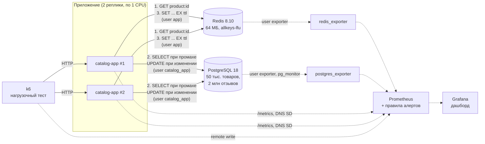
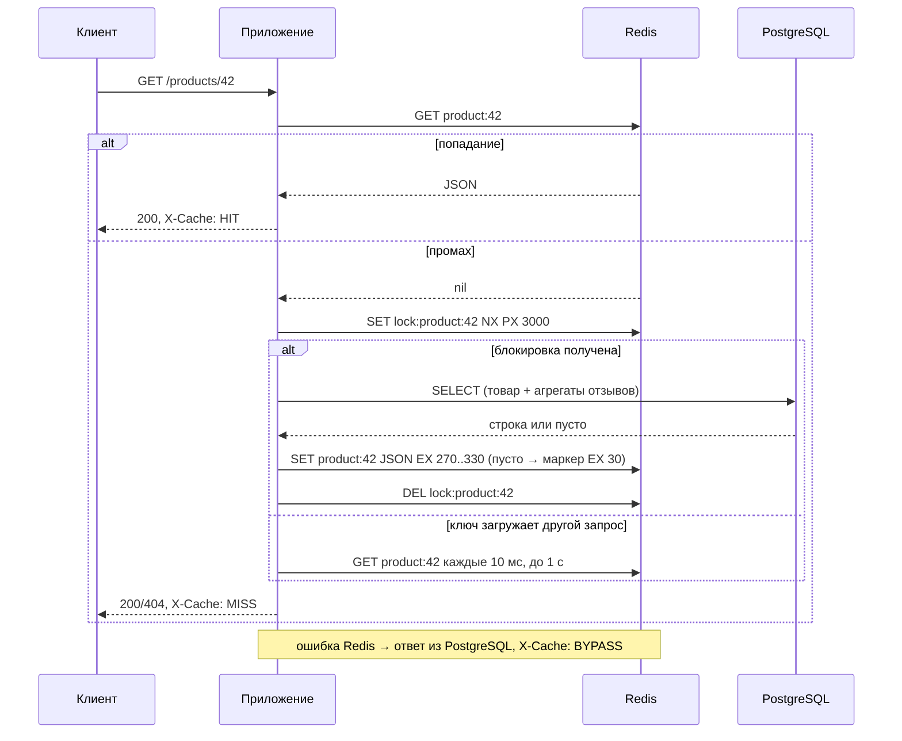
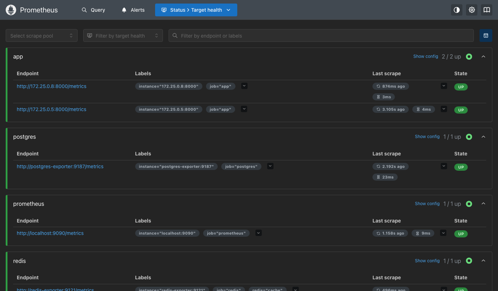
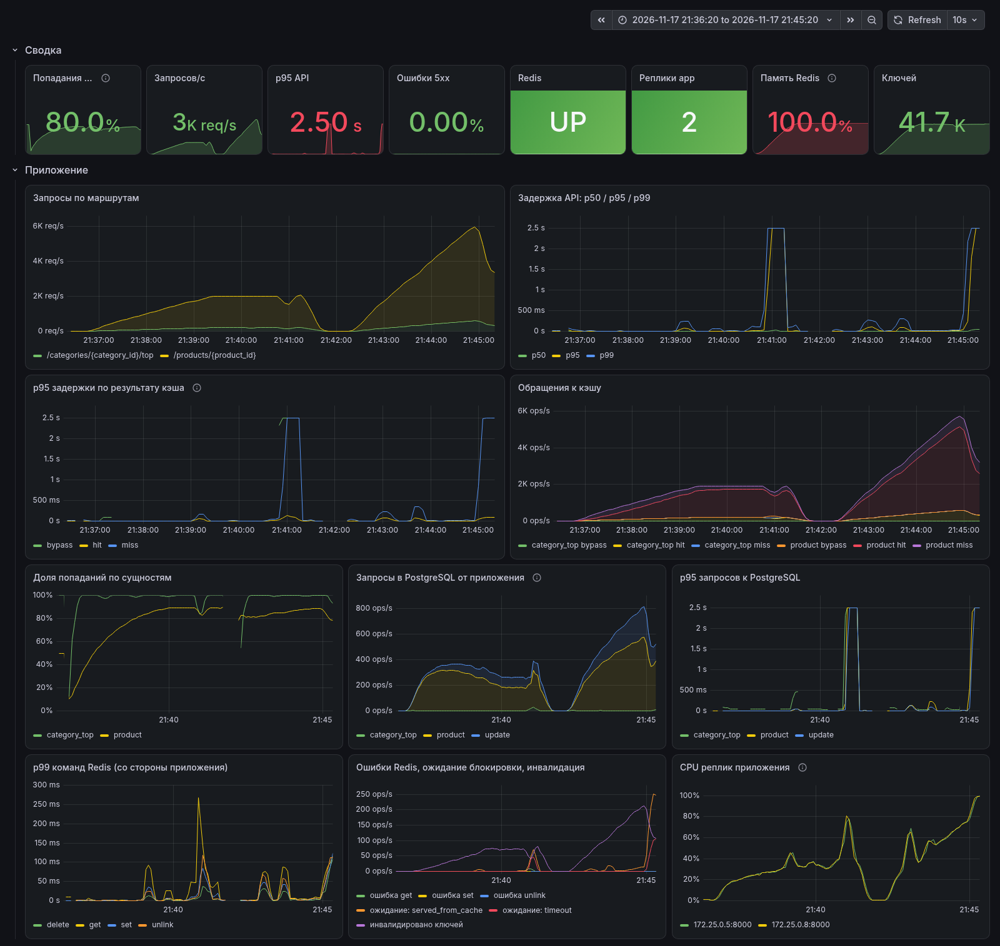
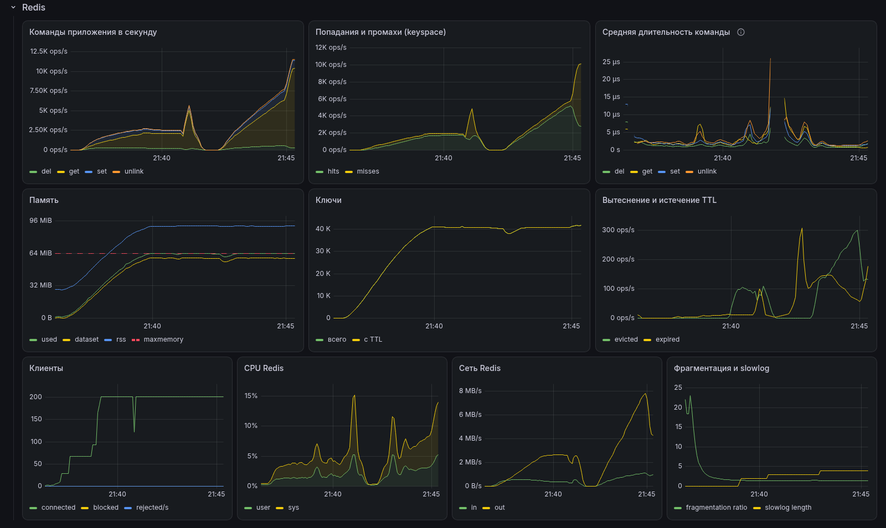
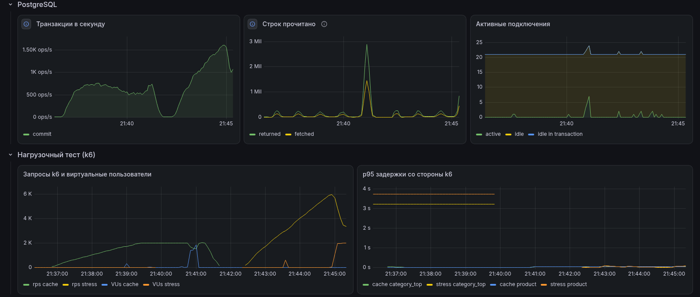
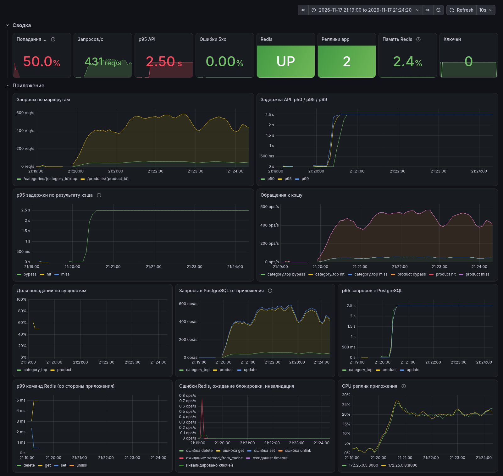
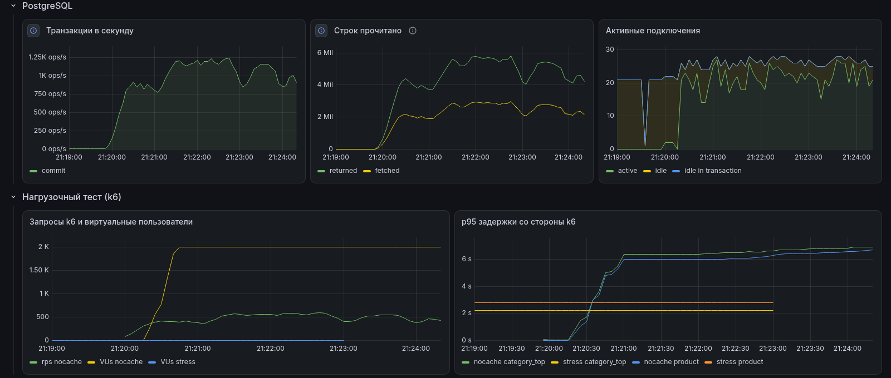

# Отчёт по лабораторной работе № 3

**Дисциплина:** Нереляционные базы данных
**Тема:** Эксплуатация Redis: кэширование данных основной БД

---

## 1. Цель работы

Получить навыки эксплуатации Redis в роли кэша перед основной БД: спроектировать и развернуть
сервис, ограничить доступ к Redis ролевой моделью, проверить поведение системы под нагрузкой
и при отказе Redis, подключить мониторинг и построить дашборд.

## 2. Задание

1. Выбрать сценарий и предметную область.
2. Описать решаемую задачу и требования к системе.
3. Подготовить архитектурную схему.
4. Развернуть Redis и необходимые компоненты (допускается Docker).
5. Реализовать минимально работающее приложение.
6. Провести нагрузочное тестирование.
7. Настроить мониторинг Redis и приложения.
8. Создать дашборд с метриками состояния и производительности.

## 3. Сценарий и требования

### 3.1. Выбор сценария

Выбран **сценарий 1 — кэширование данных основной БД**. Предметная область — **каталог
интернет-магазина**: карточки товаров с рейтингом и последними отзывами и топ-20 товаров
категории по рейтингу. Каталог — типичный кандидат на кэш:

* чтений на порядки больше, чем изменений (цена и остаток меняются редко);
* популярность товаров неравномерна: небольшая доля товаров получает большую часть запросов;
* карточка товара собирается агрегированием отзывов, а топ категории — агрегированием
  ~50 тыс. строк, поэтому каждое обращение к PostgreSQL стоит дорого;
* небольшое отставание данных (секунды — минуты) для витрины допустимо.

### 3.2. Решаемая задача

Сервис отдаёт данные каталога по HTTP. Без кэша каждое обращение выполняет агрегирующий
запрос к PostgreSQL, и при росте нагрузки БД становится узким местом. Redis хранит готовые
JSON-ответы, и повторные запросы обслуживаются из памяти, не доходя до БД.

| Метод | Путь | Источник | Ключ Redis, TTL |
|---|---|---|---|
| GET | `/products/{id}` | карточка: товар, категория, рейтинг (среднее и гистограмма), 5 последних отзывов | `product:{id}`, 300 с ± 10 % |
| GET | `/categories/{id}/top` | топ-20 товаров категории по среднему рейтингу | `category:{id}:top`, 60 с ± 10 % |
| PATCH | `/products/{id}` | изменение цены/остатка в PostgreSQL | удаляет `product:{id}`, при смене цены и `category:{id}:top` |
| GET | `/health`, `/metrics` | состояние зависимостей, метрики Prometheus | — |

### 3.3. Требования

**Функциональные**

* Шаблон cache-aside: чтение из Redis, при промахе — из PostgreSQL с записью в Redis.
* После изменения товара следующий запрос возвращает новые данные (инвалидация по записи).
* Запросы несуществующих товаров не нагружают БД повторно (кэширование 404).
* Одновременные промахи по одному ключу не порождают лавину одинаковых запросов в БД.
* Ответ показывает, откуда пришли данные (заголовок `X-Cache: HIT | MISS | BYPASS`).

**Нефункциональные**

* **Производительность:** 2000 запросов/с при p95 карточки товара < 100 мс (порог k6).
* **Отказоустойчивость:** недоступность Redis не приводит к ошибкам — запросы обслуживаются
  из PostgreSQL.
* **Ограниченная память:** кэш не больше 64 МБ, при заполнении вытесняются редкие ключи.
* **Безопасность:** доступ к Redis и PostgreSQL только по паролю, у каждого клиента
  минимальные права; базы не опубликованы на хосте.
* **Наблюдаемость:** метрики приложения, Redis, PostgreSQL и нагрузочного теста в одном
  Prometheus, дашборд Grafana, правила алертов.
* **Воспроизводимость:** стенд поднимается одной командой, версии образов зафиксированы.

## 4. Среда выполнения

| Компонент | Версия |
|---|---|
| Хост | macOS 27.2 (Apple Silicon), Docker Engine 28.5.2, Docker Compose 2.40.3 (8 ГБ ОЗУ для Docker) |
| Redis | 8.10.3 (`redis:8.10.3`) |
| PostgreSQL | 18.7 (`postgres:18.7`) |
| Приложение | Python 3.14.10, FastAPI 0.163.1, uvicorn 0.54.0 (uvloop, httptools), redis-py 8.1.0, asyncpg 0.32.0, prometheus-client 0.26.0 |
| Мониторинг | Prometheus 3.16.0, redis_exporter 1.97.0, postgres_exporter 0.20.1, Grafana 13.3.1, grafana-image-renderer 5.12.11 |
| Нагрузка | k6 2.4.0 (выход `experimental-prometheus-rw`) |

## 5. Архитектура



Чтение карточки (cache-aside с защитой от лавины промахов):



| Контейнер | Назначение | Ограничения | Порт на хосте |
|---|---|---|---|
| `postgres` | основная БД, данные создаются при первом запуске | 2 CPU, 1 ГБ | — |
| `redis` | кэш, ACL-файл генерируется из `.env` | 1 CPU, 256 МБ | — |
| `app` × 2 | API каталога | по 1 CPU, 256 МБ | `127.0.0.1:8001-8004` |
| `redis-exporter`, `postgres-exporter` | метрики Redis и PostgreSQL | — | — |
| `prometheus` | сбор метрик, приём метрик k6, алерты | — | `127.0.0.1:9090` |
| `grafana` | дашборд | — | `127.0.0.1:3000` |
| `k6` (профиль `loadtest`) | нагрузочный тест | — | — |
| `renderer` (профиль `screenshots`) | снимки дашборда для отчёта | — | — |

Redis и PostgreSQL доступны только во внутренней сети Compose; веб-интерфейсы и приложение
опубликованы только на `127.0.0.1`.

### Структура проекта

```
lab-3-redis/
├── docker-compose.yml          # весь стенд, версии образов зафиксированы
├── .env.example                # пароли и режим кэша (скопировать в .env)
├── app/                        # приложение: main.py, Dockerfile, requirements.txt
├── db/                         # схема, тестовые данные, роли PostgreSQL
├── redis/                      # redis.conf, entrypoint.sh (генерация ACL)
├── monitoring/
│   ├── prometheus/             # prometheus.yml, alerts.yml
│   └── grafana/                # provisioning и дашборд redis-cache.json
├── loadtest/
│   ├── catalog.js              # сценарий k6
│   └── results/                # итоги прогонов (txt — сводка, json — полный отчёт k6)
├── scripts/
│   ├── check.sh                # проверка стенда, матрица доступа
│   ├── demo.sh                 # демонстрация работы кэша и отказа Redis
│   ├── loadtest.sh             # прогон k6 с кэшем или без
│   └── screenshots.sh          # снимки дашборда
└── img/                        # скриншоты для отчёта
```

---

## 6. Ход выполнения

### 6.1. Развёртывание

```bash
cp .env.example .env
docker compose up -d --build --wait
```

Первый запуск занимает около минуты: PostgreSQL выполняет скрипты из `db/` — схему, тестовые
данные (40 категорий, 50 000 товаров, 2 000 035 отзывов, 451 МБ; `setseed` делает набор
одинаковым при каждом развёртывании) и роли. У всех сервисов есть проверки здоровья,
и приложение стартует только после того, как PostgreSQL и Redis готовы.

**Настройки Redis** (`redis/redis.conf`) подобраны под роль кэша:

| Параметр | Значение | Почему |
|---|---|---|
| `maxmemory` | `64mb` | кэш не должен расти неограниченно; 64 МБ вмещают ~41 тыс. карточек из 50 тыс., поэтому под нагрузкой видно вытеснение |
| `maxmemory-policy` | `allkeys-lfu` | вытесняются редко запрашиваемые ключи; при неравномерной популярности LFU удерживает «горячие» товары лучше, чем LRU |
| `lfu-decay-time` | `1` | счётчик частоты затухает каждую минуту — популярность пересчитывается быстро |
| `lazyfree-lazy-*` | `yes` | освобождение памяти при вытеснении и истечении TTL — в фоновом потоке |
| `save ""`, `appendonly no` | — | персистентность не нужна: источник истины — PostgreSQL, кэш прогревается заново |
| `slowlog-log-slower-than`, `latency-monitor-threshold`, `latency-tracking` | 10 мс, 10 мс, вкл. | диагностика медленных команд и перцентили задержек для экспортёра |

**ACL Redis.** Пользователь `default` выключен. `entrypoint.sh` при старте контейнера
генерирует `users.acl` из паролей в `.env` (в файл попадают только SHA-256 хеши паролей):

| Пользователь | Ключи | Команды | Кто использует |
|---|---|---|---|
| `admin` | все | все | администратор |
| `app` | `product:*`, `category:*`, `lock:*` | `get set del unlink exists ttl ping` + подключение | приложение |
| `exporter` | нет | `info`, `config get`, `slowlog get/len`, `latency latest/histogram`, `client list`, `dbsize`, `memory stats`, `command info` + подключение | redis_exporter |

Набор команд экспортёра проверен по `ACL LOG`: первоначально экспортёру не хватало
`COMMAND INFO`, после добавления журнал отказов пуст.

**Роли PostgreSQL** (`db/03-roles.sh`): владелец БД `catalog_owner` используется только при
инициализации; приложение работает под `catalog_app` (`SELECT` на три таблицы, `UPDATE` только
столбцов `price`, `stock`, `updated_at`), экспортёр — под `exporter` с ролью `pg_monitor`.

**Проверка** — `scripts/check.sh`: контейнеры, настройки Redis, матрица доступа к Redis
и PostgreSQL, приложение и мониторинг. При любом расхождении скрипт завершается с ошибкой.

```
$ ./scripts/check.sh
== Redis
  версия                                      redis_version:8.10.3
  maxmemory                                   67108864
  maxmemory-policy                            allkeys-lfu
  save                                        "" (снимки RDB выключены)
  appendonly                                  no
  пользователи                                admin app default exporter
== Матрица доступа Redis (+ разрешено, - отклонено)
  [app] SET product:check                     + OK
  [app] GET product:check                     + 1
  [app] SET session:1 (чужой префикс)         - NOPERM No permissions to access a key
  [app] KEYS *                                - NOPERM User app has no permissions to ru
  [app] FLUSHALL                              - NOPERM User app has no permissions to ru
  [app] CONFIG SET maxmemory                  - NOPERM User app has no permissions to ru
  [exporter] INFO                             + # Memory
  [exporter] CONFIG GET maxmemory             + maxmemory
  [exporter] GET product:check                - NOPERM User exporter has no permissions
  [exporter] CONFIG SET maxmemory             - NOPERM User exporter has no permissions
  [default] GET без пароля (default)          - NOAUTH Authentication required.
  [app] неверный пароль                       - AUTH failed: WRONGPASS invalid username-
  [admin] ACL WHOAMI                          + admin
== Права в PostgreSQL (пользователь catalog_app)
  SELECT count(*) FROM reviews                + 2000035
  UPDATE products SET stock                   + BEGIN
  UPDATE products SET name                    - ERROR:  permission denied for table prod
  DELETE FROM reviews                         - ERROR:  permission denied for table revi
  CREATE TABLE                                - ERROR:  permission denied for schema pub
== Приложение
  реплика 1 (127.0.0.1:8001) /health          {"db":true,"redis":true,"cache_enabled":true}
  реплика 2 (127.0.0.1:8002) /health          {"db":true,"redis":true,"cache_enabled":true}
== Мониторинг
  цели Prometheus                             app=up app=up postgres=up prometheus=up redis=up
  правила алертов                             10 правил, firing: нет
  Grafana                                     ok 13.3.1
  дашборд                                     Redis Lab — кэш каталога - 33 панелей
```

### 6.2. Приложение

`app/main.py` — асинхронный сервис на FastAPI. Основные решения:

* **Cache-aside** (`get_or_load`): Redis хранит готовый JSON-ответ, при попадании он
  отдаётся без повторной сериализации.
* **Разброс TTL ± 10 %** — ключи, записанные одновременно, истекают не одновременно.
* **Кэширование отсутствующих товаров** — маркер на 30 с; перебор несуществующих
  идентификаторов не нагружает БД.
* **Защита от лавины промахов** — при промахе запрос берёт блокировку `SET lock:<ключ> NX PX 3000`;
  остальные запросы с тем же ключом ждут появления значения в кэше (до 1 с), а не идут в БД.
* **Инвалидация** после записи в БД. Топ категории содержит цену, но не остаток, поэтому
  сбрасывается только при изменении цены, иначе обновляется по TTL.
* **Отказ Redis.** Таймаут команды — 250 мс, пул соединений с ожиданием
  (`BlockingConnectionPool`, 100 соединений на реплику). Любая ошибка Redis влияет только
  на текущий запрос: он обслуживается из PostgreSQL (`X-Cache: BYPASS`). После 5 ошибок
  подряд приложение 2 с не обращается к Redis, чтобы не тратить время на таймауты.
* **Режим без кэша** (`CACHE_ENABLED=false`) — для сравнения под нагрузкой.
* **Метрики** (prometheus-client): запросы и задержка HTTP по маршруту и результату кэша,
  обращения к кэшу (hit/miss/bypass), задержка команд Redis и запросов к БД, ошибки Redis,
  ожидания блокировки, инвалидации, пул соединений с БД.

Проверка функций — `scripts/demo.sh`:

```
$ ./scripts/demo.sh
== 1. Cache-aside: товар 6349
  1-й запрос (реплика 1): code=200 time=0.004664s X-Cache=MISS
  2-й запрос (реплика 1): code=200 time=0.001358s X-Cache=HIT
  3-й запрос (реплика 2): code=200 time=0.001550s X-Cache=HIT
  ключ product:6349: TTL 306 с, 1575 байт
== 2. Инвалидация при изменении
  цена до:      40291.13
  PATCH:        {"id":6349,"invalidated":["product:6349","category:30:top"]}
  ключ после:   EXISTS=0
  GET (реплика 2): code=200 time=0.006673s X-Cache=MISS, цена 999.99
== 3. Кэширование отсутствующих товаров
  1-й запрос: code=404 time=0.003064s X-Cache=MISS
  2-й запрос: code=404 time=0.001816s X-Cache=HIT
  ключ product:106431: TTL 30 с
== 4. Лавина промахов: 200 одновременных запросов к холодному ключу
  запросов топа категории 6 в PostgreSQL: 2 на 200 HTTP-запросов
  дождались значения в кэше: 19
== 5. Отказ Redis
  Redis остановлен, запрос 1: code=200 time=0.007421s X-Cache=BYPASS
  Redis остановлен, запрос 2: code=200 time=0.012768s X-Cache=BYPASS
  Redis остановлен, запрос 3: code=200 time=0.010195s X-Cache=BYPASS
  /health: {"db":true,"redis":false,"cache_enabled":true}
  ошибок Redis в приложении: 3
  Redis запущен, запрос 1: code=200 time=0.011079s X-Cache=MISS
  Redis запущен, запрос 2: code=200 time=0.003769s X-Cache=HIT
```

Что видно:

* Кэш общий для реплик: ключ, записанный репликой 1, читает реплика 2.
* После `PATCH` следующий запрос — промах, и он возвращает новую цену.
* Из 200 одновременных запросов к холодному ключу в БД ушло 2, а не 200. Второй запрос
  проскочил в узкое окно между удалением блокировки и чтением ключа; 19 запросов дождались
  значения, остальные пришли уже после записи и попали в кэш.
* При остановленном Redis сервис продолжает отвечать 200 из PostgreSQL, `/health` показывает
  `redis: false`; после запуска Redis кэш снова наполняется.

### 6.3. Нагрузочное тестирование

**Сценарий** `loadtest/catalog.js` (k6, исполнитель `ramping-arrival-rate` — задаётся темп
запросов, а не число пользователей, поэтому медленная система не «разгружает» тест сама):

| Доля | Запрос |
|---|---|
| 85 % | `GET /products/{id}`, id = ⌊50000·u⁴⌋+1: ~30 % запросов приходится на 1 % товаров, ~55 % — на 10 % |
| 10 % | `GET /categories/{1..40}/top` |
| 4 % | `PATCH /products/{id}` (новый остаток) |
| 1 % | `GET` несуществующего товара (ожидается 404) |

Профиль: 30 с разгон до ¼ цели, 2 мин рост до цели, удержание, 20 с спад. Пороги:
ошибок < 1 %, p95 карточки и 404 < 100 мс, p95 топа и изменения < 250 мс. Метрики k6
пишутся в тот же Prometheus (метка `testid`).

```bash
./scripts/loadtest.sh nocache off 2000 2m        # только PostgreSQL
./scripts/loadtest.sh cache   on  2000 2m        # Redis, холодный старт
COLD=0 ./scripts/loadtest.sh stress on 6000 1m   # поиск предела, прогретый кэш
```

**Итоги** (`loadtest/results/*.txt`, задержки — со стороны k6, мс):

| Прогон | Цель, RPS | Средний RPS | Пропущено итераций | Карточка p50 / p95 / p99 | Топ p50 / p95 | Попадания | BYPASS | Ошибки |
|---|---|---|---|---|---|---|---|---|
| без кэша | 2000 | 464 | 282 811 | 3693 / 6693 / 9887 | 3988 / 6906 | — | 129 951 (100 %) | 0 % |
| с кэшем | 2000 | 1418 | 6 970 | 0,55 / 44,5 / 1146 | 0,48 / 40,2 | 83,0 % | 1 838 | 0 % |
| стресс, с кэшем | 6000 | 3229 | 150 650 | 1,17 / 395 / 4095 | 1,03 / 90,7 | 86,2 % | 2 490 | 0 % |

Средний RPS включает разгон и спад; на участке удержания прогон с кэшем держал заданные
2000 RPS. Сводка k6 по прогону с кэшем:

```
requests: 411279  rate: 1418.15/s  failed: 0.00%
product       avg 47.10 ms  p50 0.55  p95 44.52  p99 1145.57  max 11933.85
category_top  avg 57.53 ms  p50 0.48  p95 40.20  p99 1566.19  max 13078.28
update        avg 138.34 ms  p50 1.21  p95 187.28  p99 4496.97  max 11557.68
missing       avg 166.36 ms  p50 0.91  p95 183.50  p99 4800.35  max 9690.91
cache: hit 326244  miss 66755  bypass 1838  hit ratio 83.0%
dropped_iterations: 6970  max VUs: 1934
```

Ход прогонов по метрикам Prometheus (интервал 15 с):

```
без кэша: RPS приложения     ... 400 ... 560 (максимум) ... — дальше рост невозможен, p95 упирается в 2,5 с
с кэшем:  RPS                 142  387  594  780  970 1150 1340 1530 1720 1830 2000 2000 2000 2000 2000 2000 1980 1420 2150
          доля попаданий     0.27 0.43 0.51 0.60 0.66 0.72 0.76 0.80 0.83 0.85 0.87 0.89 0.90 0.91 0.91 0.90 0.86 0.88 0.91
          p95 (сервер), мс    4.4  2.5  2.2  2.2  2.0  1.6  1.6  1.4  1.8   93  1.5  1.3  1.7  2.0  1.6   28 2010 2500   28
стресс:   RPS                 382 1110 1700 2320 2880 3300 4010 4570 5130 5690 5870 3420 2830 3070 2960
          CPU приложения     0.29 0.52 1.27 0.80 0.87 1.21 1.12 1.20 1.34 1.45 1.54 1.98 1.97 1.98 1.77   (из 2)
          запросов в БД/с      80  221  318  418  496  538  618  676  736  771  779  497  449  485  590
          CPU Redis           2 %  4 %  10 %  6 %  5 %  8 %  6 %  7 %  8 %  8 %  8 %  13 % 15 % 14 % 13 %
```

**Выводы по нагрузке.**

* **Без кэша** система обрабатывает не более ~560 запросов/с, причём сам k6 смог отправить
  в среднем 464/с: остальные 282 тыс. итераций пропущены, потому что 2000 виртуальных
  пользователей ждали ответа по 3–10 с. Узкое место — PostgreSQL (2 CPU): каждый запрос топа
  категории агрегирует ~50 тыс. строк (40 мс в простое, сотни миллисекунд под нагрузкой).
* **С кэшем** заданные 2000 RPS выдерживаются, p95 на установившемся участке — 1,3–2 мс,
  против 6,7 с без кэша при вчетверо меньшей нагрузке. Доля попаданий растёт
  с 27 % на холодном кэше до 90 % за ~3 минуты. Число запросов в PostgreSQL падает с ~560/с
  до ~260/с при вчетверо большем трафике.
* **Предел с кэшем** — ~5,8 тыс. запросов/с (в ~10 раз выше, чем без кэша). Узкое место
  смещается в приложение: две реплики Python используют 2 из 2 выделенных CPU. Redis при
  этом занят на 8–15 % одного ядра, средняя длительность команды внутри Redis — 2–10 мкс.
* **Память.** 64 МБ заполняются за ~3 минуты (41,7 тыс. ключей), дальше работает вытеснение
  LFU (до ~300 ключей/с в стрессе), доля попаданий при этом остаётся 86–91 %.
* **Волна истечения TTL.** Примерно через 5 минут после старта (21:41) одновременно истекли
  ключи, записанные при прогреве: доля попаданий просела до 0,86, число запросов в БД
  выросло, и на ~30 с p95 вырос до 2 с — отсюда p99 = 1,1 с в сводке k6. Разброс TTL ± 10 %
  не спасает, когда тысячи ключей записаны за одну минуту прогрева. Решения — больший
  разброс или вероятностное раннее обновление ключа до истечения (XFetch).

**Проблемы, найденные нагрузочным тестом.** Первые прогоны с кэшем не выдерживали 2000 RPS;
итоги сохранены в `loadtest/results/cache-v1.txt` и `cache-v2.txt`.

1. **Шторм инвалидаций** (`cache-v1`: 1138 RPS, 75 % попаданий). Каждый `PATCH` товара
   удалял ещё и топ его категории. При 80 изменениях в секунду на 40 категорий топ каждой
   категории сбрасывался дважды в секунду, и тяжёлый агрегирующий запрос уходил в БД
   ~48 раз/с вместо ~0,7 (40 ключей / 60 с). Исправление: топ сбрасывается только при
   изменении цены, остаток в нём не показывается.
2. **Переполнение пула соединений Redis.** С обычным пулом (`max_connections=200`) при
   всплеске запросы получали ошибку «Too many connections» и уходили в БД. Исправление:
   пул с ожиданием (`BlockingConnectionPool`).
3. **Каскадный отказ из-за выключателя** (`cache-v2`: 1337 RPS, 18 543 BYPASS, p95 карточки
   2,6 с; предыдущий прогон почти того же кода — отличалась только метка BYPASS — случайно прошёл с p95 1,5 мс). Первая версия
   отключала Redis на 2 с после **любой** ошибки. Под нагрузкой единичный таймаут 100 мс
   переводил весь трафик реплики (~1000 RPS) в PostgreSQL, который выдерживает ~500 RPS.
   Запросы скапливались, таймаутов Redis становилось больше, и система не выходила
   из перегрузки. Исправление: ошибка влияет только на текущий запрос, отключение Redis —
   после 5 ошибок подряд, таймаут увеличен до 250 мс. После исправления BYPASS — 1 838
   на 411 тыс. запросов.

### 6.4. Мониторинг

Prometheus опрашивает цели раз в 5 секунд. Реплики приложения находятся через
`dns_sd_configs`: встроенный DNS Docker возвращает адрес каждого контейнера сервиса `app`,
поэтому при масштабировании (`APP_REPLICAS`) новые реплики попадают в мониторинг сами.
k6 отправляет метрики через remote write (`--web.enable-remote-write-receiver`).



**Метрики и зачем они нужны:**

| Группа | Метрики | Зачем |
|---|---|---|
| Эффективность кэша | `app_cache_requests_total{entity,result}`, `redis_keyspace_hits_total / misses_total` | доля попаданий — главный показатель пользы кэша; разрез по сущностям показывает, какой ключ «не держится» |
| Задержка | `app_http_request_duration_seconds{route,cache}` | p50/p95/p99 в целом и отдельно для hit/miss/bypass — видно, сколько экономит кэш |
| Нагрузка на БД | `app_db_query_duration_seconds{query}`, `pg_stat_database_xact_commit`, `tup_returned` | сколько запросов не обслужено кэшем и как это сказывается на БД |
| Отказы | `app_cache_errors_total{op,error}`, доля `bypass`, `redis_up`, `up{job="app"}` | недоступность Redis и работа в обход кэша |
| Лавина промахов, инвалидации | `app_cache_lock_waits_total{outcome}`, `app_cache_invalidations_total` | работа блокировки и частота сброса ключей |
| Память Redis | `redis_memory_used_bytes`, `redis_memory_max_bytes`, `redis_memory_used_rss_bytes`, `redis_mem_fragmentation_ratio` | насколько кэш заполнен и сколько памяти реально занимает процесс |
| Вытеснение и TTL | `redis_evicted_keys_total`, `redis_expired_keys_total`, `redis_db_keys` | частое вытеснение — кэшу мало памяти; всплеск истечений — синхронное истечение TTL |
| Производительность Redis | `redis_commands_total`, `redis_commands_duration_seconds_total`, `redis_cpu_*_seconds_total`, `redis_net_*_bytes_total`, `app_redis_command_duration_seconds` | нагрузка на Redis и задержка команд внутри Redis и со стороны клиента (разница — сеть и очередь) |
| Подключения | `redis_connected_clients`, `redis_blocked_clients`, `redis_rejected_connections_total`, `app_db_pool_connections` | исчерпание `maxclients` и пулов |
| Ресурсы | `process_cpu_seconds_total{job="app"}`, `slowlog_length` | CPU реплик (узкое место в стрессе), медленные команды |
| Нагрузочный тест | `k6_http_reqs_total`, `k6_vus`, `k6_http_req_duration_p95{name}` | задержка глазами клиента рядом с серверными метриками |

**Правила алертов** (`monitoring/prometheus/alerts.yml`): `RedisDown`, `RedisMemoryNearLimit`
(> 95 % maxmemory), `RedisHighEvictionRate` (> 100 ключей/с), `RedisRejectedConnections`,
`CacheHitRatioLow` (< 80 % при заметном трафике), `CacheErrors`, `AppInstanceDown`,
`AppHighLatencyP95` (> 100 мс), `AppErrorRate` (> 1 % 5xx), `PostgresDown`. За время тестов
сработали ожидаемые: `AppHighLatencyP95` (прогон без кэша и перегрузка в стрессе),
`CacheErrors` (остановка Redis в `demo.sh`, таймауты в первых прогонах), `CacheHitRatioLow`
(прогрев холодного кэша), `RedisMemoryNearLimit` и `RedisHighEvictionRate` (кэш заполнен).

### 6.5. Дашборд

Дашборд `monitoring/grafana/dashboards/redis-cache.json` подключается через provisioning
и открывается как домашний (`http://127.0.0.1:3000`, обновление каждые 10 с). 33 панели
в пяти разделах: сводка, приложение, Redis, PostgreSQL, нагрузочный тест. Скриншоты сняты
`scripts/screenshots.sh` через grafana-image-renderer.

**Прогон с кэшем и стресс-тест** (21:36–21:45):



* «Доля попаданий по сущностям»: топ категорий почти сразу выходит на ~100 % (40 ключей),
  карточки — плавно до 90 % по мере прогрева.
* «Запросы в PostgreSQL»: после прогрева поток в БД снижается при растущем трафике.
* «p95 по результату кэша»: hit — около 1 мс, miss — несколько миллисекунд, кроме двух
  перегрузок: волны истечения TTL в 21:41 и предела в конце стресса.
* «CPU реплик приложения»: в конце стресса обе реплики упираются в 100 % — предел системы.



* «Память»: used растёт до пунктирной линии maxmemory (64 МБ) и останавливается — дальше
  вытеснение; RSS ~90 МБ (накладные расходы аллокатора).
* «Ключи»: рост до ~41 тыс. и плато; провал в 21:41 — волна истечения TTL.
* «Вытеснение и истечение TTL»: вытеснение начинается после заполнения памяти, всплески
  `expired` — истечение ключей, записанных при прогреве.
* «CPU Redis» — не выше 15 %, «Средняя длительность команды» — единицы микросекунд.



**Прогон без кэша** (21:19–21:24), для сравнения:



Все обращения к кэшу — bypass, поток в PostgreSQL равен потоку запросов (~400–560/с),
задержки p50/p95/p99 упираются в верхнюю границу гистограммы 2,5 с (реальные значения
по k6 — 3,7 / 6,7 / 9,9 с), CPU приложения — около 20 %: приложение простаивает в ожидании БД.



---

## 7. Сводка проверки

| Проверка | Результат |
|---|---|
| Развёртывание | ✓ `docker compose up -d --build --wait`, 8 контейнеров, проверки здоровья пройдены |
| ACL Redis | ✓ `default` выключен, у `app` и `exporter` минимальные права, матрица из 13 проверок совпадает |
| Права PostgreSQL | ✓ приложение может только читать и менять цену/остаток |
| Cache-aside, инвалидация, кэш 404 | ✓ `demo.sh`: MISS → HIT, после PATCH новая цена, повторный 404 из кэша |
| Защита от лавины промахов | ✓ 2 запроса в БД на 200 одновременных промахов |
| Отказ Redis | ✓ ответы 200 из PostgreSQL, восстановление после запуска Redis |
| Нагрузка 2000 RPS | ✓ с кэшем: 0 % ошибок, p95 на плато 1,3–2 мс, 90 % попаданий; без кэша: предел ~560 RPS, p95 6,7 с |
| Предел системы | ✓ ~5,8 тыс. RPS с кэшем, ограничение — CPU приложения |
| Мониторинг | ✓ 5 / 5 целей up, 10 правил алертов, дашборд из 33 панелей |

## 8. Выводы

1. Redis в роли кэша перед PostgreSQL по шаблону cache-aside поднял пропускную способность
   каталога примерно в 10 раз (~560 → ~5,8 тыс. запросов/с) и снизил p95 при 2000 RPS
   с секунд до 1–2 мс. Узкое место сместилось с БД на приложение, а Redis при этом занят
   на 8–15 % одного ядра.
2. Польза кэша определяется долей попаданий, а она — распределением популярности, TTL
   и объёмом памяти. При 64 МБ на 50 тыс. товаров LFU-вытеснение удерживает 86–91 %
   попаданий: редкие товары вытесняются, популярные остаются.
3. Корректная работа кэша — это не только GET/SET: нужны инвалидация после записи,
   кэширование отсутствующих ключей, защита от лавины промахов и разброс TTL. Инвалидация
   должна затрагивать только данные, которые реально изменились: лишний сброс тяжёлого
   агрегата обнулил выигрыш от кэша.
4. Кэш должен быть необязательной зависимостью: при отказе Redis сервис продолжает работать
   через БД. Но БД не рассчитана на весь трафик, поэтому обход кэша нужно включать только
   при реальном отказе, а не при единичном таймауте под нагрузкой, иначе возникает каскадный
   отказ.
5. Нагрузочное тестирование вместе с мониторингом нашло три дефекта, которые не видны
   на одиночных запросах. Дашборд, где рядом показаны доля попаданий, поток в БД,
   задержки hit/miss и ресурсы Redis, позволяет сразу увидеть причину деградации.

---

## Приложение. Запуск

```bash
cd lab-3-redis
cp .env.example .env                       # при необходимости сменить пароли
docker compose up -d --build --wait        # стенд
./scripts/check.sh                         # проверка
./scripts/demo.sh                          # демонстрация кэша
./scripts/loadtest.sh cache on 2000 2m     # нагрузка с кэшем
./scripts/loadtest.sh nocache off 2000 2m  # нагрузка без кэша
docker compose down -v                     # удалить стенд вместе с данными
```

Снимки дашборда (нужен Python с Pillow для нарезки):

```bash
docker compose --profile screenshots up -d renderer
./scripts/screenshots.sh cache 2026-11-17T18:36:20Z 2026-11-17T18:45:20Z
```

| Сервис | Адрес | Учётная запись |
|---|---|---|
| API, реплика N | `http://127.0.0.1:<порт>` (`docker compose port --index N app 8000`) | — |
| Grafana | `http://127.0.0.1:3000` | `admin` / `GRAFANA_ADMIN_PASSWORD` |
| Prometheus | `http://127.0.0.1:9090` | — |
| Redis CLI | `docker compose exec redis redis-cli --user admin --pass <REDIS_ADMIN_PASSWORD>` | `admin` |
| psql | `docker compose exec postgres psql -U catalog_owner -d catalog` | `catalog_owner` |

Пароли — в `.env` (шаблон — `.env.example`).
